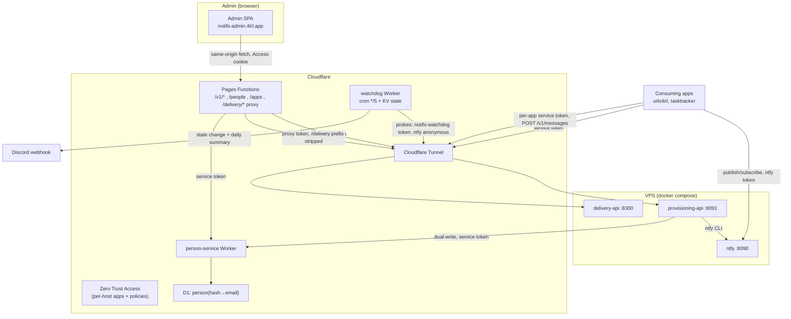
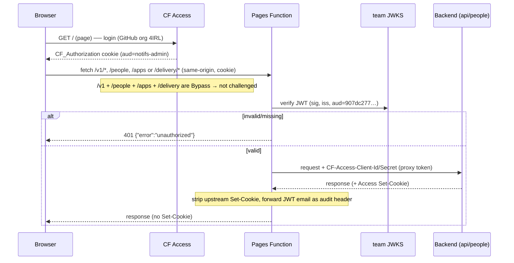
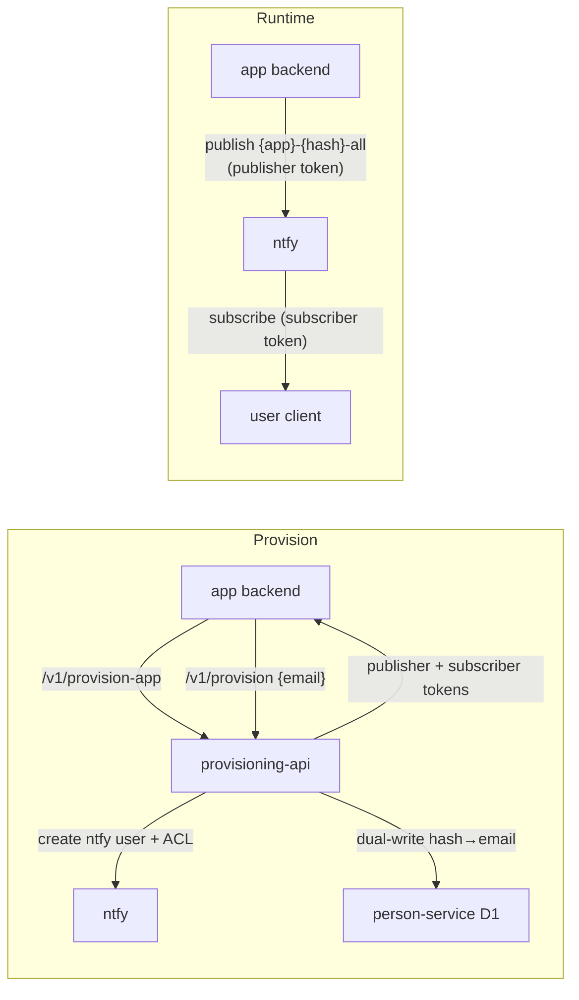
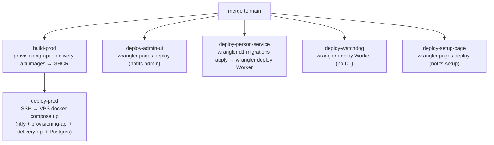

# 4irl-notifs — Architecture

Self-hosted notification hub for the 4IRL app family, built on [ntfy](https://ntfy.sh). Consuming
apps (urls4irl, tasktracker, …) provision users and push **personalized** notifications; end users
receive only their own messages. This doc is the single source of truth for how it works and how it's
wired in Cloudflare — enough to operate and debug it. For how a *client app* integrates, see
[`docs/app-integration-guide.md`](docs/app-integration-guide.md).

## Components

| Component            | Tech                                            | Host                     | Role                                                                              |
| -------------------- | ----------------------------------------------- | ------------------------ | --------------------------------------------------------------------------------- |
| **ntfy**             | ntfy `v2.26.0`, Docker (VPS)                    | `notifs.4irl.app`        | Pub/sub server. Topics, users, ACLs, tokens. `auth-default-access: deny-all`.     |
| **provisioning-api** | Go, Docker (VPS)                                | `notifs-api.4irl.app`    | Creates ntfy users/tokens/ACLs by shelling to the `ntfy` CLI. HTTP API (`/v1/*`). |
| **delivery-api**     | Go + Postgres, Docker (VPS)                     | `notifs-delivery.4irl.app` (Tunnel → `127.0.0.1:8300`) | Generic delivery service: `/healthz`, `/readyz`, the operator `/v1/admin` registry API, `/v1/messages` (submit, status read and `DELETE` cancel) and the operator `/v1/admin/scheduled-messages` list and cancel. Runs an in-process delivery worker (SSRF-guarded webhook and Discord sinks, an ntfy sink, and `to.recipient` delivery), a scheduled-message releaser (`RunReleaser`), a retention sweeper and the heartbeat checker (30 s tick). Has no auth of its own; reachable only behind the path-scoped Access apps below. |
| **person-service**   | Cloudflare Worker + D1                          | `notifs-people.4irl.app` | Reverse index `person_hash → email`. No auth of its own (Access is its boundary). |
| **admin UI**         | React/Vite → Cloudflare Pages + Pages Functions | `notifs-admin.4irl.app`  | Human console. SPA + same-origin `/v1/*`, `/people`, `/apps` and `/delivery/*` proxy Functions. |
| **watchdog**         | Cloudflare Worker (cron `*/5`) + one Workers KV key | none (cron-only, `workers_dev = false`) | External monitor on Cloudflare's network, independent of the VPS. Probes delivery-api `/readyz` (including `heartbeat_checker.stale`), provisioning-api `/healthz` and ntfy `/v1/health` through the Tunnel with the `notifs-watchdog` service token, keeps last-known state in KV, and posts changes plus a daily summary (16:00 UTC) to a dedicated Discord webhook. A KV read that throws with nothing to post skips the state write, so the summary date and each target's `since` are not reset. |
| **setup page**       | React/Vite → Cloudflare Pages (static)          | `notifs-setup.4irl.app`  | Public ntfy setup walkthrough linked from every app. No API calls, no Access. See "Setup page". |

Two live environments: **local** (docker-compose: ntfy + provisioning-api + delivery-api + Postgres) and
**production** (the VPS + Cloudflare). ntfy + provisioning-api + delivery-api (with its Postgres) run on
the VPS; person-service + admin UI are Cloudflare-native.

### delivery-api endpoints

- `GET /healthz`, `GET /readyz` — liveness and readiness (database reachable, migrations current).
  `/readyz` also carries `heartbeat_checker: {last_tick_at, stale}` (`stale` when the checker has not
  ticked for 90 s). Staleness never changes the status or the HTTP code, because the prod compose
  healthcheck probes `/readyz` and a stalled checker must not mark the container unhealthy; the watchdog
  and the admin status card interpret the field instead.
- `POST /v1/heartbeats/{app_id}/{name}` and `POST /v1/heartbeats/{app_id}/{name}/fail` — the app-facing
  pings (outside `/v1/admin`, so an app token may call them). `200 {"app_id","name","state"}`; `404` for an
  unknown check. `/v1/admin/heartbeats` (`POST`, `GET`) and `/v1/admin/heartbeats/{id}` (`GET`, `PATCH`,
  `DELETE`) plus `POST /v1/admin/heartbeats/{id}/pause` and `/resume` — the operator check CRUD (Heartbeats
  section of the Delivery tab). A check holds 1-20 destinations (a destination a check uses cannot be
  deleted); a `down` or `recovered` alert is one message per destination through the normal pipeline.
  The ping routes do not bind `app_id` to the caller's identity: authentication is the Cloudflare Access
  whole-host policy shared by all app service tokens (the same model as `/v1/messages`), so any
  authorized app token can ping or fail any app's check. Accepted for trusted first-party apps; per-check
  ping secrets or per-app Access path policies are the future options.
  Contract and client examples are in `docs/app-integration-guide.md` ("Heartbeats").
- `/v1/admin/destinations` (`POST`, `GET`) and `/v1/admin/destinations/{name}` (`GET`, `PATCH`, `DELETE`) —
  the destination registry. Destination secrets are sealed with AES-256-GCM before they are stored and
  are masked on every read. `PATCH` merges both `config` and `secrets` per key (keys not in the patch are
  kept; the merged result is validated, and nothing is written on error); neither can have a key removed
  through `PATCH`, so clearing an optional secret such as the ntfy `access_token` requires deleting and
  recreating the destination.
- `POST /v1/admin/destinations/{name}/rotate-secret` (body `{"overlap_hours": 1..168}`) — webhook
  destinations only. Moves the current `signing_secret` to `signing_secret_previous`, sets
  `config.previous_secret_expires_at` to now + overlap, generates a new secret and returns it once as
  `signing_secret` beside the masked destination. `invalid overlap_hours` → 400, ntfy/discord → 422,
  unknown name → 404. A second rotation during an open overlap invalidates the first rotation's secret
  immediately.
- `/v1/admin/routes` (`POST`, `GET`) and `/v1/admin/routes/{id}` (`GET`, `PATCH`, `DELETE`) — the routes
  that map to destinations.
- `/v1/admin/apps/{app_id}/ntfy-publisher` (`POST`, `GET`, `DELETE`) — the per-app ntfy publisher token
  that `to.recipient` delivery publishes with. `POST` mints one through provisioning-api
  (`DELIVERY_PROVISIONING_URL`; unset answers 503) and stores it sealed, `GET` returns the record (never
  the token), and `DELETE` removes delivery-api's stored copy (idempotent, 204) so recipient submits fail
  closed until a re-mint. It does not revoke the token in ntfy.

- `POST /v1/messages` (submit, optional `?wait=N`), `GET /v1/messages/{id}?app_id=` and
  `GET /v1/messages?app_id=&idempotency_key=` — the app envelope API. A future `deliver_at` holds the
  message (status `scheduled`) until a release poller (1s interval, batches of 100) moves it into the
  queue; the app cancels or replaces it until then with `DELETE /v1/messages/{id}?app_id=` and
  `DELETE /v1/messages?app_id=&idempotency_key=` (idempotent 200; replace is a re-post of the same
  idempotency key with different content). An app may hold at most `DELIVERY_MAX_SCHEDULED_PER_APP`
  scheduled messages (default 1000, range 1-100000; an invalid value fails startup), else `429`
  `too many scheduled messages`. All apps together may hold at most `DELIVERY_MAX_SCHEDULED_TOTAL`
  (default 100000, range 1-10000000; an invalid value fails startup), else `429`
  `scheduled message capacity reached`; this bounds table growth across `app_id`s. Both caps are
  checked in the insert transaction under advisory locks taken in a fixed order (global, then app), the
  per-app cap first when both are full, and a replace never grows either count so it is never refused.
  The operator **Pending sends** list and cancel are `GET /v1/admin/scheduled-messages` (optional
  `limit`, default 50, max 200; returns `scheduled_messages` and `total`) and
  `DELETE /v1/admin/scheduled-messages/{id}` (the app cancel without the app scoping).
  The in-process worker delivers each queued message to its webhook, Discord or ntfy destination (or,
  for `to.recipient`, to the person's ntfy topic) with retries. The operator delivery log lives under
  `/v1/admin/deliveries` (`GET`, optional `state` and `limit`), `GET /v1/admin/deliveries/{id}/attempts`
  and `POST /v1/admin/deliveries/{id}/replay`; the list and replay return the admin delivery view
  (the app-facing fields plus `message_id`, `app_id`, `channel`, `destination_type`, `created_at`,
  `updated_at`). The full envelope contract is in `docs/app-integration-guide.md`.
- Retention sweeper: an in-process sweeper deletes messages older than `DELIVERY_RETENTION_DAYS`
  (default 30, integer 1-3650; an invalid value fails startup). A message with a `pending` or
  `scheduled` delivery is never deleted. A message's age counts from the later of `created_at` and
  `deliver_at`, so a long-scheduled message keeps its full retention after release; a cancelled message
  ages from `cancelled_at` instead.

**Exposure and authentication.** delivery-api has no authentication of its own and stays bound to
`127.0.0.1:8300`; Cloudflare Access is its only boundary. It is published through the shared Tunnel as
`notifs-delivery.4irl.app` (public hostname → `http://localhost:8300`) behind one **Service Auth Access
application** for the whole hostname, whose policy allows the admin proxy token only. App tokens are not
authorized yet, so apps cannot reach `/v1/messages` until the operator adds them.

**Before the first app is onboarded, or the `notifs-watchdog` token is authorized** (the watchdog is a
non-proxy token on this host too), split the hostname into two path-scoped Access apps, most specific
path first: `notifs-delivery.4irl.app/v1/admin` (proxy token only, so an app token gets 403 on the
`ntfy-publisher` mint, which makes provisioning-api create an ntfy publisher user and token for any
`app_id`, and on rotate-secret) and the whole hostname (the proxy token plus the per-app tokens, for
`/v1/messages`, `/readyz` and `/healthz`). Never add an app token to a policy that covers `/v1/admin`.

`app_id` on `/v1/messages` is still caller-asserted: any holder of an authorized token can submit as, or
read the status of, any app (and can cancel or replace any app's scheduled messages through
`DELETE /v1/messages` and replace-by-repost), so per-app tokens are an operator-trust boundary, not
isolation between apps. Never publish the hostname before its Access app exists. Operator runbook: create the Access app
and add the proxy token, add the Tunnel public hostname, then set the Pages `DELIVERY_API_URL` binding and
add `/delivery` to the `notifs-admin` Bypass app.

## System diagram

## Hosts & DNS (all under the `4irl.app` Cloudflare zone)

| Host                     | Fronted by                | Access-gated?            | Origin                       |
| ------------------------ | ------------------------- | ------------------------ | ---------------------------- |
| `notifs-admin.4irl.app`  | Cloudflare Pages          | Yes (human login)        | Pages project `notifs-admin` |
| `notifs-api.4irl.app`    | Tunnel → `127.0.0.1:8091` | Yes (service-token only) | provisioning-api container   |
| `notifs.4irl.app`        | Tunnel → `127.0.0.1:8090` | **No** (ntfy token auth) | ntfy container               |
| `notifs-people.4irl.app` | Worker custom domain      | Yes (service-token only) | person-service Worker        |
| `notifs-delivery.4irl.app`   | Tunnel → `127.0.0.1:8300` | Yes (service-token only; path-scoped, see below) | delivery-api container |
| `notifs-setup.4irl.app`  | Cloudflare Pages          | **No** (public static page) | Pages project `notifs-setup` |

- The Tunnel is a **shared, remotely-managed** connector (also fronts urls4irl); notifs routes were
  added as public hostnames — no new daemon/credential, dashboard-only.
- ntfy is deliberately **not** behind Access (mobile/CLI clients can't do an OAuth redirect); its
  own token auth is the boundary.
- `notifs-setup.4irl.app` is deliberately **public**: it is a static page that holds no secrets, so it
  must have no Access application, and no wildcard `*.4irl.app` Access app may cover it (see "Setup
  page" below).

---

## Authentication (Cloudflare Zero Trust)

Zero Trust team domain: **`urls4irl.cloudflareaccess.com`** (shared with urls4irl). JWT issuer =
`https://urls4irl.cloudflareaccess.com`; JWKS = `…/cdn-cgi/access/certs`.

### Access applications

| App                       | Domain(s)                                      | AUD tag           | Policy                                                                               |
| ------------------------- | ---------------------------------------------- | ----------------- | ------------------------------------------------------------------------------------ |
| `notifs-admin`            | `notifs-admin.4irl.app`                        | `907dc277…575f`   | `U4I Dev Policy` — **Allow**, GitHub org `4IRL` (human login)                        |
| `notifs-admin` API bypass | `notifs-admin.4irl.app/v1`, `/people`, `/apps`, `/delivery` | —                 | **Bypass** (Everyone) — Access does NOT gate these paths; the Function authenticates |
| `notifs-delivery`         | `notifs-delivery.4irl.app`                     | (dashboard)       | **Service Auth** (proxy token only; per-app tokens, the `notifs-watchdog` token and a `/v1/admin` split come with the first onboarded app or the watchdog) |
| `notifs-api`              | `notifs-api.4irl.app`                          | `91ad97d9…694150` | **Service Auth** (proxy token) only                                                  |
| `notifs-people`           | `notifs-people.4irl.app`                       | `5a270164…658f5a` | **Service Auth** (VPS dual-write token + proxy token) only                           |

- `U4I Dev Policy` is a **reusable** Allow policy shared with `notifs-admin`. On the backends it was
  *detached* (Step-7 lockdown), leaving them service-token-only. Never *delete* it (would break admin login).
- The AUD tag is per-app; `ACCESS_JWT_AUD` on the Pages project must equal `notifs-admin`'s AUD (`907dc277…`).
- ⚠️ **The API-bypass path list is dashboard-managed and must include every same-origin API path.** When a
  new proxied path is added (e.g. `/apps` for the app registry, `/delivery` for delivery-api), the
  operator must add it to this Bypass application alongside `/v1` and `/people` — otherwise Access edge-challenges non-GET requests to it
  (`POST`/`PATCH`/`DELETE` → 302 login → 405), exactly the failure in the debugging table below. `GET`
  still works, so the symptom is "list renders but every mutation fails."

### Service tokens

| Token                           | Presented by                                          | Authorized on                               |
| ------------------------------- | ----------------------------------------------------- | ------------------------------------------- |
| `notifs-admin-proxy → backends` | Pages Function (`CF-Access-Client-Id/Secret`)         | `notifs-api` + `notifs-people` + `notifs-delivery` Service Auth apps |
| VPS dual-write token            | provisioning-api (Go)                                 | `notifs-people` Service Auth                |
| per-consuming-app tokens        | tasktracker backend (live); urls4irl backend (future) | `notifs-api` Service Auth; the whole-host `notifs-delivery` app once split from `/v1/admin` (never the `/v1/admin` app) |
| `notifs-watchdog`               | watchdog Worker (secrets `CF_ACCESS_CLIENT_ID/SECRET`) | `notifs-api` Service Auth; the whole-host `notifs-delivery` app **excluding `/v1/admin`** (only after the `/v1/admin` split exists) |

### Admin-UI request flow (the important one)

**Why the design is shaped this way (hard-won, keep):**
- Access **challenges same-origin `fetch` POSTs** (302→login, downgrading POST→GET → 405). Fix: the
  **Bypass** app on `/v1`, `/people`, `/apps` and `/delivery` takes those paths off Access's edge; the **Function validates the
  JWT itself** (`web/functions/_auth.ts`).
- The backends' Access **Set-Cookie** (`CF_Authorization` for the service token) must be **stripped**
  by the proxy, or it overwrites the admin's human cookie on `notifs-admin.4irl.app` → 401 loop.
- Auth is **fail-closed**: unset `ACCESS_JWT_AUD` (without the `DISABLE_ACCESS_AUTH=true` local flag)
  → `500`, never open.

---

## Admin-UI same-origin proxy

- SPA calls **relative** `/v1/*`, `/people`, and `/apps` (same-origin) — no cross-origin browser requests.
- `web/functions/`: `_proxy.ts` (shared helper), `v1/[[path]].ts`, `people.ts`, `apps/[[path]].ts`,
  `_auth.ts` (JWT), `_http.ts`. `/v1/*` → provisioning-api; `/people` + `/apps` → person-service.
- Function: validate Access JWT → forward to backend with the proxy service token → strip upstream
  `Set-Cookie` → return. People view gated by `VITE_PEOPLE_ENABLED=true`, Apps view by `VITE_APPS_ENABLED=true`.
- **Delivery proxy** (`web/functions/delivery/[[path]].ts`) → delivery-api at `DELIVERY_API_URL`, with the
  `/delivery` prefix stripped (browser `/delivery/v1/admin/destinations` → upstream
  `/v1/admin/destinations`; the query string is kept). delivery-api has no auth of its own, so the
  Function is stricter than the other proxies, in this order: **allowlist → cross-site guard → `proxyTo`**
  (JWT auth runs inside `proxyTo`):
  - Allowlist (anything else is `404 {"error":"not found"}` with no upstream call): `GET /delivery/readyz`,
    `POST /delivery/v1/messages`, and any method on `/delivery/v1/admin/<at least one segment>`. The match
    is on the normalized path on a segment boundary; `%2f`, `%5c` and `//` are refused.
  - Cross-site guard on every non-GET (HEAD and OPTIONS included): needs `Sec-Fetch-Site: same-origin` or
    an `X-Requested-With` header, else `403 {"error":"cross-site request refused"}`; a request with a body
    must be `Content-Type: application/json`, else `415 {"error":"unsupported media type"}`. The guard runs
    before auth, so an unauthenticated cross-site write is 403, not 401.
  - The Delivery tab is gated by `VITE_DESTINATIONS_ENABLED=true` (status card, Destinations, Routes) and
    `VITE_PENDING_SENDS_ENABLED=true` (Pending sends) and `VITE_DELIVERY_LOG_ENABLED=true` (Delivery Log)
    and `VITE_HEARTBEATS_ENABLED=true` (Heartbeats; requires `VITE_DESTINATIONS_ENABLED`).
    The Pending sends section lists scheduled messages (soonest first) and cancels one through
    `DELETE /delivery/v1/admin/scheduled-messages/{id}`, a non-GET that the existing `/delivery` Access
    Bypass and the Pages Function allowlist already cover.

**Pages project `notifs-admin` — runtime bindings** (set in dashboard, not committed):

| Binding                      | Type      | Value / purpose                                                    |
| ---------------------------- | --------- | ------------------------------------------------------------------ |
| `PROVISIONING_API_URL`       | plaintext | `https://notifs-api.4irl.app`                                      |
| `PERSON_SERVICE_URL`         | plaintext | `https://notifs-people.4irl.app`                                   |
| `DELIVERY_API_URL`           | plaintext | `https://notifs-delivery.4irl.app`                                     |
| `PROXY_ACCESS_CLIENT_ID`     | secret    | proxy service token client id                                      |
| `PROXY_ACCESS_CLIENT_SECRET` | secret    | proxy service token client secret                                  |
| `ACCESS_TEAM_DOMAIN`         | plaintext | `urls4irl.cloudflareaccess.com` (JWKS host + issuer)               |
| `ACCESS_JWT_AUD`             | plaintext | `notifs-admin` AUD (`907dc277…`)                                   |
| `DISABLE_ACCESS_AUTH`        | plaintext | **local dev only** (`true` disables JWT check). Never set in prod. |

Build-time (in `pages-deploy.yml`): `VITE_PEOPLE_ENABLED=true`, `VITE_APPS_ENABLED=true`,
`VITE_DESTINATIONS_ENABLED=true`, `VITE_DELIVERY_LOG_ENABLED=true`, `VITE_PENDING_SENDS_ENABLED=true`, `VITE_HEARTBEATS_ENABLED=true`.

---

## Setup page

`https://notifs-setup.4irl.app` is a public, self-contained static page that walks an end user through
installing and configuring the ntfy app (iPhone: ordered steps with copy buttons; Android: one-tap
`ntfy://` subscribe buttons; desktop: a QR handoff plus a phone picker). Consuming apps link to it as
`?app=<app_id>&user=u_<hash>&name=<display name>`; the URL contract is in
[`docs/app-integration-guide.md`](docs/app-integration-guide.md) ("Link your users to the setup page").

- **Layout:** `setup-web/` is a sibling project to `web/` (React + Vite + `qrcode.react`, bundled at
  build time; its own `package.json`, Vitest unit tests, Playwright e2e). It deploys to its own Pages
  project `notifs-setup`, separate from `notifs-admin`, so none of the admin UI's Access-proxy
  Functions or `jose` ship with it. Make targets: `make setup-web-*`.
- **No API calls.** The page parses the query string, derives the topics locally
  (`{app}-{hash}-all`, `{app}-broadcast`) and talks to nothing. It never sees the subscriber password
  (the user types that into the ntfy app).
- **Privacy posture (`setup-web/public/_headers`):** `Referrer-Policy: no-referrer`, a CSP of
  `default-src 'none'` with only same-origin script, style and image (`connect-src 'none'`, no fonts,
  no framing), `X-Robots-Tag: noindex`, `nosniff`, and a restrictive `Permissions-Policy`. The URL
  carries a user's ntfy id, so the page must not leak it by referrer, analytics or third-party
  requests. Its screenshots are first-party, same-origin assets.
- **Screenshots go stale.** `setup-web/public/screenshots/` holds real captures of the ntfy iOS and
  Android apps, taken by hand. When ntfy changes its UI they drift from reality; re-capture them (the
  manifest test in `setup-web/src/screenshots.test.ts` checks the files and their dimensions, not that
  they still match the app).
- **Deploy:** `prod-build-and-deploy.yml` fans out `deploy-setup-page` (`setup-pages-deploy.yml`,
  `wrangler pages deploy` to `notifs-setup`, production branch `main`) next to the admin UI deploy.
  The Pages project and the custom domain `notifs-setup.4irl.app` are **dashboard-managed operator
  prerequisites** that must exist before the first deploy, as must the absence of any Access
  application on the hostname (and any wildcard `*.4irl.app` Access app that would cover it).
- **CI:** the check `CI and Tests / Test / Setup page end-to-end` runs the Playwright suite. It is a
  new check name; if branch protection on `main` lists required checks by name, the operator must add it
  there once it has reported.

---

## Notification model

- **Identity = email** → `person_hash` (`sha256(trim+lowercase(email))` → base32, 16 chars). Same
  email = same person across every app. ntfy user id = `u_<person_hash>`.
- **Two tokens** (each revealed once at mint):

| Token          | Endpoint                            | ntfy ACL                             | Held by                   |
| -------------- | ----------------------------------- | ------------------------------------ | ------------------------- |
| **Publisher**  | `POST /v1/provision-app {app_id}`   | write-only `{app_id}-*`              | app backend (one per app) |
| **Subscriber** | `POST /v1/provision {app_id,email}` | read-only `{app_id}-{person_hash}-*` | end-user client           |

- **Subscriber auth — token vs. password.** The subscriber token (above) is what an app hands a
  programmatic/Android client to subscribe. **iOS is different:** the ntfy iOS app's subscribe screen has
  **no token field**, so an iOS subscriber logs into the ntfy app with a **username + password** —
  `u_<person_hash>` + a **self-chosen password** the app sets for them via `POST /v1/set-password`. The
  ntfy access token is therefore Android/programmatic-only; iOS relies on the password path. (Same ntfy
  user either way — the password and the token are two auth methods onto the one `u_<person_hash>` identity.)
- **Topics:** `{app_id}-{person_hash}-{channel}`, with the standard channel `all` (one per app; others
  only by explicit need). Publisher writes any `{app_id}-*`; subscriber reads its own
  `{app_id}-{person_hash}-*`.
- **Broadcast topic:** `{app_id}-broadcast` — one shared per-app topic for site-wide / maintenance
  announcements. Every subscriber is granted **read** on it at `Provision` (always-on per app — no
  per-user opt-out); the publisher writes it via its existing write-only `{app_id}-*` grant (no new
  publisher credential). The read grant is reset at `Deprovision` (and on `DeprovisionApp` teardown).
  `POST /v1/provision` returns it as `broadcast_topic`. **Send authz is app-side:** ntfy authenticates the
  app-level publisher token, not the app's users, so restricting who may *trigger* a broadcast to that
  app's admins is the consuming app's responsibility (see the integration guide's broadcast section).
- **person-service D1** table `person(person_hash PK, email, created_at)` — reverse index so an
  operator can map an opaque hash back to an email. Populated by the provisioning-api **dual-write**
  (Go) on every `/v1/provision`, and **dual-deleted** on a full user teardown (`DELETE /v1/users/{id}`
  or a deprovision that removes the user's last app).
- **person-service D1** table `app(app_id PK, display_name, description, created_at)` — the first-class
  **app registry**, the operator-facing catalog behind the admin UI's Apps section (list/add/edit/remove).
  It is advisory metadata layered over ntfy's still-derived reality: `POST /v1/provision` does **not**
  require an app to be registered, so the registry and ntfy can diverge (an app with ntfy subscribers but
  no registry row is not shown). The provisioning-api best-effort dual-deletes the row when an app is torn
  down via `POST /v1/deprovision-app`.

### provisioning-api endpoints (`notifs-api.4irl.app`, all Service-Auth gated)

`POST /v1/provision` · `POST /v1/deprovision` · `POST /v1/set-password` · `GET /v1/users` ·
`DELETE /v1/users/{user_id}` · `POST /v1/provision-app` · `POST /v1/deprovision-app` ·
`POST /v1/test-notify` · `GET /healthz`. Bodies +
responses are JSON; errors `{ "error": … }`. Notes: `DELETE /v1/users/{id}` is idempotent (200 even when
the ntfy user is already gone; it also dual-deletes the person row). `POST /v1/provision-app` takes an
optional `rotate` (default false = additive mint; true = revoke existing publisher tokens then mint one).
`POST /v1/deprovision-app {app_id}` fully removes an app (publisher identity + every subscriber grant +
registry row). `POST /v1/test-notify {app_id, recipients, channel?, message?, title?}` mints an ephemeral
write-only publisher token, publishes the message to each recipient's `{app_id}-{person_hash}-{channel}`
topic, then revokes the token in an always-run cleanup; per-recipient failures are reported inside a 200
response. `channel` defaults to `all`; `title` defaults to `<app_id> test` (the admin UI sends
`<display name> test`) and is ≤256 bytes with no control characters. `ntfypublish` sends the title as
a `Title` header (RFC 2047-encoded when non-ASCII).
`POST /v1/set-password {app_id, email, password}` → `{user_id, app_id, updated}` sets a person's
ntfy password (via `ntfy user change-pass`) so they can log into the ntfy iOS app directly with
`u_<person_hash>` + that password; the user must already be provisioned (missing user → `404
{"error":"user does not exist"}`), the password is validated at 8–128 chars (`400 {"error":"invalid
password"}`), and like every `/v1/*` route it is Service-Auth gated at the edge (no Go-level auth). Full
contract: `docs/app-integration-guide.md` + `provisioning-api/internal/httpapi`.

### Scheduling & time-based notifications are app-owned — notifs stays a dumb pipe

> **Superseded in part:** delivery-api now provides delivery retries, backoff and a delivery log for
> envelopes submitted to `/v1/messages`, and a one-shot **deferred send**: an app may set `deliver_at` to
> have delivery-api hold an already-composed message and release it into the queue when due (cancel or
> replace until then; see `docs/app-integration-guide.md`). Targets are validated at submit and
> re-checked at release: a destination disabled or deleted before `deliver_at` ends as a dead delivery
> (`destination_disabled` / `destination_deleted`), visible in the Delivery log. The rest of the
> scheduling decision below still stands: no cron, recurring schedules or decision logic here (the app
> owns staleness and what to send), and 4irl-notifs still never learns an app's domain.

**Decision:** 4irl-notifs does **not** schedule notifications and holds **no** cron, timer, or
schedule registry. Each consuming app **implements its own scheduler and its own decision logic**,
and publishes app-direct to ntfy (publisher token) when it decides to. Two kinds of trigger, both
app-side:

- **Immediate / event-driven** — an app event happens (a chore completed, a member joined a UTub);
  the app publishes right then. No clock involved.
- **Time-based / scheduled** — "is anything due / overdue / worth a daily digest?" is the passage of
  time, which no event fires for. The app runs its **own** periodic sweep (its own cron), decides
  who to notify, dedups, and publishes. The clock, the domain logic, and the dedup/high-watermark
  cursor all live **in the app**, never here.

**Why 4irl-notifs stays out of it:** every current 4IRL consumer can already schedule itself —
`tasktracker`/chore-reaper runs a `scheduled()` sweep on its own Cloudflare Worker (native Cron
Triggers, in the same Worker as its API); `urls4irl` is an always-on Flask app that crons itself
trivially. A centralized scheduler here would serve only a hypothetical app that needs scheduled
sends **yet cannot run any cron of its own** — currently an empty set. Building it now is
speculative (YAGNI), and it would drag notifs into the delivery/decision path it is deliberately out
of. The invariant to protect: **4irl-notifs never learns an app's domain** (chores, URLs, due dates,
UTubs) — it provisions identities/tokens and pipes bytes to ntfy; *what* to send and *when* is
always the app's job.

**If a can't-cron app ever onboards** (the escape hatch, documented so it isn't re-derived — **not**
built until there's a real consumer): add a schedule registry (a new `person-service` D1 table) + a
single coarse cron tick (`[triggers].crons` + a `scheduled()` handler on the person-service Worker)
that **fans in identical schedules** (one row-set per `(cron, tz)`, not per user) and makes one
**signed, batched outbound callback** per fire-bucket to the app's registered URL. Even then the app
still owns the decision and the publish — notifs would supply only the clock, never the domain
logic. Quantize any such schedules to a fixed grid (e.g. 5-minute buckets) so distinct fire moments
stay bounded and one cron trigger covers unbounded schedules (Workers free tier caps triggers at 3
per Worker — a non-issue only because the tick is a clock, not the registry).

---

## Client delivery & iOS push

Clients receive **client-direct**: the user's device holds the subscriber token and subscribes to
ntfy (`notifs.4irl.app`) directly — no app backend in the delivery path.

| Client                  | Transport                                  | Latency          |
| ----------------------- | ------------------------------------------ | ---------------- |
| Browser / desktop / web | direct stream (`/json`, `/sse`, WebSocket) | instant          |
| Android (ntfy app)      | persistent foreground-service connection   | instant          |
| iOS (ntfy app)          | **APNs, bridged via ntfy.sh** (see below)  | short wake delay |

**iOS is the special case.** iOS forbids the long-lived background connection Android uses, and the
ntfy iOS app is signed with **ntfy.sh's** APNs credentials — so a self-hosted server cannot wake it
directly. `ntfy/server.yml` sets `upstream-base-url: https://ntfy.sh`: on each publish this server
forwards a minimal **poll request** (topic name + message ID, never the body) to ntfy.sh, which sends
the APNs wake-up; the iOS app then fetches the real body **from this server**. Free ntfy.sh bridge but
rate-limited — set the `NTFY_UPSTREAM_ACCESS_TOKEN` GitHub Actions repo secret (a free ntfy.sh account
token; `prod-deploy.yml` exports it into the deploy shell as ntfy's `upstream-access-token`) to raise
the poll ceiling under bulk load. Privacy trade-off (accepted): topic names — which embed the
`person_hash` — plus timing reach ntfy.sh; message bodies never do.

**iOS device setup — exact match or silent failure.** The ntfy iOS app's **Default server** (or the
per-subscription server) must equal `base-url` **character-for-character**: `https://notifs.4irl.app`,
https scheme, no trailing slash. The APNs wake-up references the server by `base-url`; if the app's
server URL differs at all, it can't correlate the wake to a subscription and silently fetches nothing.
(`base-url` is `http://localhost:8090` in the committed file for local dev; prod overrides it to
`https://notifs.4irl.app` via `NTFY_BASE_URL`.)

**iOS login is username+password, not a token.** Unlike Android/programmatic clients (which subscribe
with the subscriber token), the ntfy iOS app's subscribe screen has no token field — an iOS user signs
in with **`u_<person_hash>` + a self-chosen password**, which the app sets for them via `POST
/v1/set-password` (see the endpoint inventory and `docs/app-integration-guide.md`). So the integration
step for iOS is: provision the subscriber, then call `set-password` so they have a credential to log in
with; the subscriber access token remains Android/programmatic-only.

**Retention:** `cache-duration: 24h` — a client offline, or an iOS device fetching after a delayed
wake, backfills missed messages via `since=` for up to 24h.

## Deploy pipeline

`prod-build-and-deploy.yml` runs on **merge to `main`** and fans out:

- **VPS deploy** (`prod-deploy.yml`): SSH via `cloudflared access ssh` (own SSH key + deploy service
  token), SCPs compose + ntfy config, `docker compose up -d`. Dual-write creds delivered as Docker
  Compose secrets (`PERSON_SERVICE_ACCESS_CLIENT_*`), never a plaintext `.env`.
- **`DELIVERY_DB_PASSWORD` (required repo secret)**: the delivery-api Postgres password, 32+ lowercase
  hex characters (`openssl rand -hex 32`); the deploy fails before touching the VPS if it is missing or
  malformed, so set it before the first merge. Unlike the secrets above it is written to
  `secrets-persistent/` on every deploy and never deleted (delivery-api reads it on every start).
  Postgres fixes the password into the `delivery-pgdata` volume at initdb, so **rotating** the GitHub
  secret first needs `ALTER ROLE delivery PASSWORD '<new value>'` run inside `delivery-postgres`;
  otherwise migrate/api fail auth on the next deploy and it goes red.
- **`DELIVERY_MASTER_KEY` (required repo secret)**: the delivery-api master key that seals destination
  credentials at rest (AES-256-GCM), exactly 64 lowercase hex characters (`openssl rand -hex 32`); the
  deploy fails before touching the VPS if it is missing or malformed, so set it before the first merge.
  Like the DB password it is written to `secrets-persistent/` on every deploy and never deleted, but only
  delivery-api receives it (as `DELIVERY_MASTER_KEY_FILE`; `delivery-migrate` never needs it). **Back it up
  offline**: losing or changing it orphans every stored destination secret, and there is no rotation path.
  Recovery after a key loss: a destination's sealed blob can no longer be opened, so remove the routes that
  reference it, then delete and recreate the affected destinations.
- **person-service D1 schema** is applied by CI: `worker-deploy.yml` runs `wrangler d1 migrations apply
  person-service --remote` **before** `wrangler deploy`, so a new Worker code path never hits a table its
  migration hasn't created (idempotent — applied migrations are skipped). Adding a table = add a
  `person-service/migrations/NNNN_*.sql` file; no workflow change needed.
- **watchdog deploy** (`watchdog-deploy.yml`, job `deploy-watchdog`): `wrangler deploy` of `watchdog/`
  in parallel with the VPS deploy, so it survives a VPS or deploy failure. Only `CLOUDFLARE_API_TOKEN` /
  `CLOUDFLARE_ACCOUNT_ID` reach CI; the Worker's runtime secrets are set by the operator, never by CI.
  While `watchdog/wrangler.toml` still holds the placeholder KV namespace id the job skips the deploy
  with a `::notice::` (merges stay green); it deploys once the real id replaces the placeholder (runbook
  below).
- **Pages/Worker deploys**: `wrangler`, auth via repo secrets `CLOUDFLARE_API_TOKEN` (Pages-Edit +
  Workers-Scripts + D1) + `CLOUDFLARE_ACCOUNT_ID`. Worker custom domain is managed **out-of-band** in
  the dashboard (keeps the CI token account-scoped, no zone perms).
- Access apps, policies, service tokens, and Pages bindings are **dashboard-managed** (no Terraform,
  not in CI).

### Operator runbook: heartbeat watchdog (one-time, manual)

Every value below is account-specific and lives only in the Cloudflare dashboard, `wrangler` secrets or
the operator's shell; never commit one (the KV namespace id needs the repo owner's approval first).

1. **Split `notifs-delivery` first.** Create the path-scoped Service Auth app
   `notifs-delivery.4irl.app/v1/admin` (admin proxy token only) *before* authorizing any other token on the
   host, so the watchdog token never reaches `/v1/admin`.
2. Create the service token `notifs-watchdog`. Add it to the whole-host `notifs-delivery` app (not the
   `/v1/admin` one) and to `notifs-api`. ntfy needs no token (`/v1/health` is anonymous).
3. In `watchdog/`: `npx wrangler kv namespace create WATCHDOG_STATE`, put the returned id in
   `watchdog/wrangler.toml` in place of the all-zero placeholder, and commit that change only after the
   repo owner approves. The `deploy-watchdog` job skips the deploy until this is done and deploys the
   Worker on the first merge after the real id lands.
4. Create a Discord webhook in a channel dedicated to the watchdog (it must not depend on delivery-api).
5. In `watchdog/`, set the secrets (each prompts for the value): `npx wrangler secret put DISCORD_WEBHOOK_URL`,
   `npx wrangler secret put CF_ACCESS_CLIENT_ID`, `npx wrangler secret put CF_ACCESS_CLIENT_SECRET`.
6. Verify: `npx wrangler tail notifs-watchdog` shows one scheduled run within 5 minutes (the Worker
   skips the run and logs an error if `DISCORD_WEBHOOK_URL` is unset). To force a down, stop ntfy on the
   VPS (or remove the token from `notifs-api`) and expect a Discord "down" post within about 5 minutes
   and a "recovered" post after restoring it.

The Heartbeats admin section ships with its backend: `VITE_HEARTBEATS_ENABLED=true` is set in
`pages-deploy.yml` in the same change as the backend. The watchdog goes live separately, once this runbook is done.

## Debugging quick reference

| Symptom                                               | Likely cause                                                                                                                                                                                         |
| ----------------------------------------------------- | ---------------------------------------------------------------------------------------------------------------------------------------------------------------------------------------------------- |
| Admin API `500 {"error":"proxy misconfigured"}`       | A Pages binding unset/misnamed, or `ACCESS_JWT_AUD` unset in prod (fail-closed).                                                                                                                     |
| Admin API `502 {"error":"upstream auth failed"}`      | Proxy service token not on the backend's Service-Auth policy (or wrong policy action).                                                                                                               |
| Admin API `502 {"error":"upstream unreachable"}`      | `PROVISIONING_API_URL`/`PERSON_SERVICE_URL` wrong/down, or Tunnel route missing.                                                                                                                     |
| Admin API `401 {"error":"unauthorized"}`              | JWT invalid/missing: `aud`≠`notifs-admin` AUD, wrong `ACCESS_TEAM_DOMAIN`, or expired session.                                                                                                       |
| Provisioning/Apps POST/PATCH/DELETE → 302 login / 405 | The path (`/v1`, `/people`, `/apps`) is missing from the Access **Bypass** app → Access is edge-challenging the write. (Apps section lists via GET but every mutation fails until `/apps` is added.) |
| `/delivery` `502 {"error":"upstream auth failed"}`    | Proxy token not on the `notifs-delivery` Service Auth policy, or `DELIVERY_API_URL` points at the wrong host.                                                             |
| `/delivery` non-GET → 302 login / 405                 | `/delivery` is missing from the `notifs-admin` Access **Bypass** app (GETs still work, writes fail).                                                                                                 |
| `/delivery/readyz` shows `schema_mismatch`            | The delivery-api binary and database schema differ: `schema_version` ≠ `expected_schema_version` (a migration not applied, or an old binary). Check `delivery-migrate` logs and the `last_migration_failure` the status card shows. |
| Delivery status card shows "Stalled" / watchdog says "heartbeat checker stale" | The heartbeat checker has not ticked for 90 s (`/readyz` `heartbeat_checker.stale: true`): delivery-api is wedged or its checker loop died, or the process just started. Check `docker compose logs delivery-api`; a restart fixes a wedged loop. `/readyz` still answers 200, so the container stays healthy. |
| Watchdog reports delivery-api (or another target) down | Read the Discord detail: `access denied (HTTP 403/3xx)` = `notifs-watchdog` token missing from that Access app or expired; `timeout`, `request failed` or `HTTP 5xx` (e.g. 502/530) = VPS, Tunnel or the service is down (the watchdog runs on Cloudflare's network, independent of the VPS, so this is a real outage); `readiness status …` = a `/readyz` problem. Nothing posts at all = the Worker is not running: `npx wrangler tail notifs-watchdog`, then check the cron trigger and the three secrets. |
| Rotate secret → 404 right after a deploy              | The Pages UI deploys in parallel with the backend; an old `delivery-api` binary has no `rotate-secret` route. Wait for the `deploy-prod` job, then retry (not "destination does not exist"). |
| "Stalled" status card or Heartbeats load error right after the first heartbeats deploy | The Pages UI deployed before the VPS: the old `delivery-api` binary has no `/v1/admin/heartbeats` routes or `heartbeat_checker` field, and migration 0006 may not be applied yet. Wait for the `deploy-prod` job to finish, then refresh. |
| Admin API `500` "no such table: app"                  | person-service Worker deployed without applying D1 migration 0002 — run `wrangler d1 migrations apply person-service --remote` (CI does this automatically before deploy).                           |
| Direct browser visit to a backend → 403               | Expected post-lockdown (service-token-only). Rollback = re-add `U4I Dev Policy`.                                                                                                                     |
| Setup page asks for a login                           | An Access application (or a wildcard `*.4irl.app` Access app) is covering `notifs-setup.4irl.app`; the page is meant to be public. Remove or exclude the hostname from that app.                       |
| ntfy publish/subscribe 403                            | Wrong ntfy token, or topic outside the token's ACL (`{app_id}-*` publisher / `{app_id}-{hash}-*` subscriber).                                                                                        |
| iOS notifications silent/delayed (Android & web fine) | ntfy iOS app **Default server** ≠ `base-url` (`https://notifs.4irl.app`), or `upstream-base-url`/`upstream-access-token` unset or rate-limited on the server.                                        |

**Where to look:** Pages Functions logs (`wrangler pages deployment tail`); Cloudflare Access audit
logs (per-app); VPS `docker compose logs`; provisioning-api emits structured errors server-side (never
leaked to callers).

## Related docs
- `docs/app-integration-guide.md` — how a consuming app integrates (service token → provision → pub/sub).
- `CLAUDE.md` — repo conventions, commands, environments.
- Plans: `~/code/plans/4irl-notifs/completed/admin-ui-same-origin/` (the same-origin redesign + auth model).
