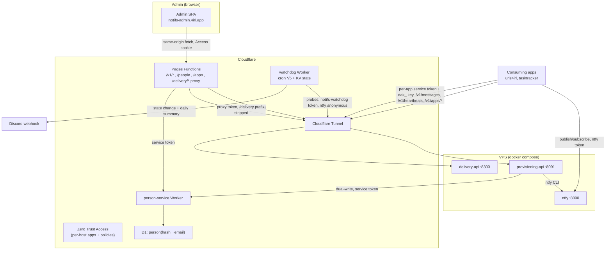
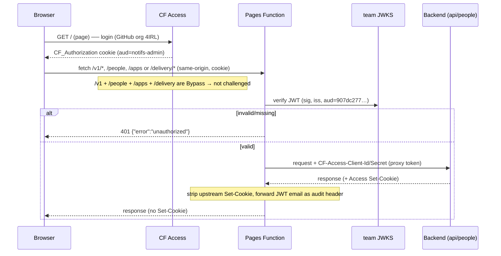
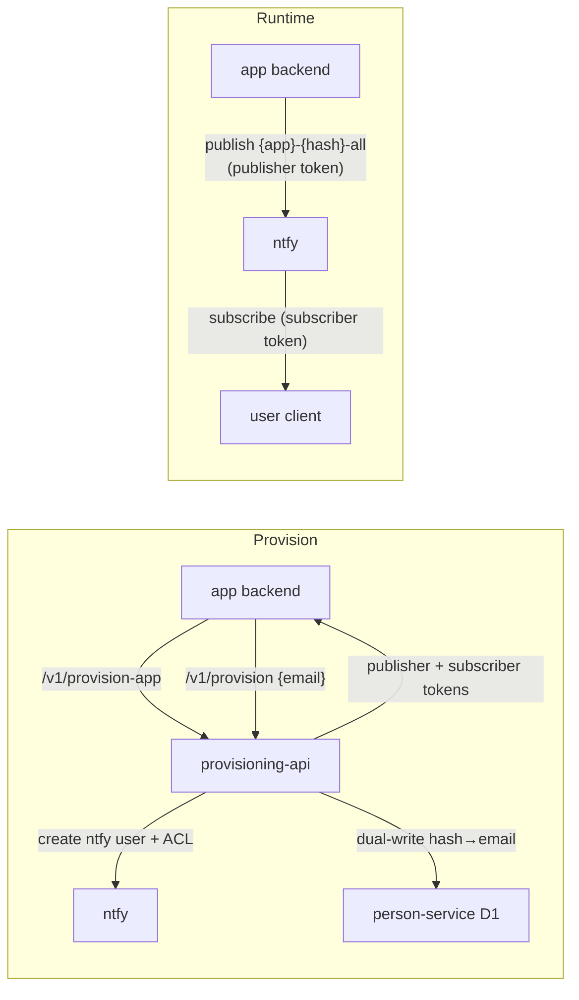
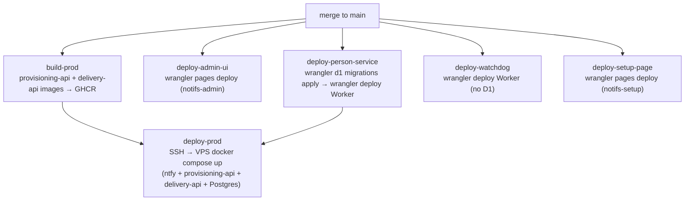

# 4irl-notifs — Architecture

Self-hosted notification hub for the 4IRL app family, built on [ntfy](https://ntfy.sh). Consuming
apps (urls4irl, tasktracker, …) provision users and push **personalized** notifications; end users
receive only their own messages. This doc is the single source of truth for how it works and how it's
wired in Cloudflare — enough to operate and debug it. For how a *client app* integrates, see
[`docs/app-integration-guide.md`](docs/app-integration-guide.md).

## Components

| Component            | Tech                                            | Host                     | Role                                                                              |
| -------------------- | ----------------------------------------------- | ------------------------ | --------------------------------------------------------------------------------- |
| **ntfy**             | ntfy `v2.26.0`, Docker (VPS)                    | `notifs.4irl.app`        | Pub/sub server. Topics, users, ACLs, tokens. `auth-default-access: deny-all`.     |
| **provisioning-api** | Go, Docker (VPS)                                | `notifs-api.4irl.app`    | Creates ntfy users/tokens/ACLs by shelling to the `ntfy` CLI. HTTP API (`/v1/*`). |
| **delivery-api**     | Go + Postgres, Docker (VPS)                     | `notifs-delivery.4irl.app` (Tunnel → `127.0.0.1:8300`) | Generic delivery service: `/healthz`, `/readyz`, the operator `/v1/admin` registry API, `/v1/messages` (submit, status read and `DELETE` cancel), the app-scoped `/v1/apps/{app_id}/…` CRUD, the app identity exchange `/v1/app-identity/exchange`, the operator `/v1/admin/app-identity/*` approvals and the operator `/v1/admin/scheduled-messages` list and cancel. Runs an in-process delivery worker (SSRF-guarded webhook and Discord sinks, an ntfy sink, and `to.recipient` delivery), a scheduled-message releaser (`RunReleaser`), a retention sweeper the heartbeat checker (30 s tick) and the heartbeat prober (website probe loop, 10 s scan, bounded concurrency). Cloudflare Access is the network gate in front of it (path-scoped Access apps below); on top of that every app-facing endpoint needs the calling app's own delivery key, so the service knows which app is calling (see "App identity"). |
| **person-service**   | Cloudflare Worker + D1                          | `notifs-people.4irl.app` | Reverse index `person_hash → email`. No auth of its own (Access is its boundary). |
| **admin UI**         | React/Vite → Cloudflare Pages + Pages Functions | `notifs-admin.4irl.app`  | Human console. SPA + same-origin `/v1/*`, `/people`, `/apps` and `/delivery/*` proxy Functions. |
| **watchdog**         | Cloudflare Worker (cron `*/5`) + one Workers KV key | none (cron-only, `workers_dev = false`) | External monitor on Cloudflare's network, independent of the VPS. Probes delivery-api `/readyz` (including `heartbeat_checker.stale`; a stale or malformed `heartbeat_prober` also pages, an absent one is tolerated so an older delivery-api stays quiet), provisioning-api `/healthz` and ntfy `/v1/health` through the Tunnel with the `notifs-watchdog` service token, keeps last-known state in KV, and posts changes plus a daily summary (16:00 UTC) to a dedicated Discord webhook. A failed probe is retried once after 30 s and only the retry's verdict can alert, so a transient failure (a stray 520, or the few seconds a production deploy takes to recreate the containers) stays quiet; each attempt (`watchdog: probe id=… attempt=… ok=… http=… duration_ms=…`) and each run (`watchdog: run state=… up=… down=… transitions=… discord=… kv_write=…`) is logged and kept by Workers Logs. A KV read that throws with nothing to post skips the state write, so the summary date and each target's `since` are not reset. |
| **setup page**       | React/Vite → Cloudflare Pages (static)          | `notifs-setup.4irl.app`  | Public ntfy setup walkthrough linked from every app. No API calls, no Access. See "Setup page". |

Two live environments: **local** (docker-compose: ntfy + person-service + provisioning-api + delivery-api + Postgres) and
**production** (the VPS + Cloudflare). ntfy + provisioning-api + delivery-api (with its Postgres) run on
the VPS; person-service + admin UI are Cloudflare-native.

### delivery-api endpoints

- `GET /healthz`, `GET /readyz` — liveness and readiness (database reachable, migrations current).
  `/readyz` also carries `heartbeat_checker: {last_tick_at, stale}` (`stale` when the checker has not
  ticked for 90 s) and `heartbeat_prober: {last_tick_at, stale}` (the same shape and 90 s threshold for the
  website probe loop). Staleness never changes the status or the HTTP code, because the prod compose
  healthcheck probes `/readyz` and a stalled checker must not mark the container unhealthy; the watchdog
  and the admin status card interpret the field instead.
- `POST /v1/heartbeats/{app_id}/{name}` and `POST /v1/heartbeats/{app_id}/{name}/fail` — the app-facing
  pings (outside `/v1/admin`, so an app's Access token reaches them). They need an app key
  (`Authorization: Bearer dak_...`) whose app is the `{app_id}` in the path (another app's id is `403
  app_id does not match app key`). `200 {"app_id","name","state"}`; `404` for an unknown check. `/v1/admin/heartbeats` (`POST`, `GET`) and `/v1/admin/heartbeats/{id}` (`GET`, `PATCH`,
  `DELETE`) plus `POST /v1/admin/heartbeats/{id}/pause` and `/resume` — the operator check CRUD (Heartbeats
  section of the Delivery tab). A check holds 1-20 destinations (a destination a check uses cannot be
  deleted); a `down` or `recovered` alert is one message per destination through the normal pipeline.
  The ping routes bind `app_id` to the caller's key (the same model as `/v1/messages`), so one app can
  no longer ping or fail another app's check.
  **Probe checks.** `POST /v1/admin/heartbeats` also creates a website probe check: instead of
  `period_seconds`/`grace_seconds` (either key present at all, even `0` or `null`, is a 400) the body
  carries a `probe` object `{"url","expected_statuses","body_match"?,"timeout_seconds","interval_seconds","access_token"?}`
  where `access_token` is `{"client_id","client_secret"}`. `PATCH` takes any subset of those probe keys;
  `access_token` is a tri-state: omitted keeps the stored pair, `null` clears it, a `{client_id,client_secret}`
  pair replaces it. It is write-only: a view returns only `has_access_token`. `probe: null` on a patch is
  a 400 (`check kind is immutable`) and an unknown key at any depth is a 400. A check view gains
  `down_reason` (non-null only while `down`) and, on probe checks only, a `probe` block
  `{"url","expected_statuses","body_match","timeout_seconds","interval_seconds","consecutive_failures","failure_threshold","has_access_token","last_result":{"at","status","reason"}}`
  (`failure_threshold` is 3 today; read it from the view). A push ping or `/fail` on a probe check is
  `409 check is a probe check`, and an app cannot create one through `/v1/apps/{app_id}/heartbeats` (400).
  Contract and client examples are in `docs/app-integration-guide.md` ("Heartbeats").
- `/v1/admin/destinations` (`POST`, `GET`) and `/v1/admin/destinations/{name}` (`GET`, `PATCH`, `DELETE`) —
  the destination registry. Destination secrets are sealed with AES-256-GCM before they are stored and
  are masked on every read. `PATCH` merges both `config` and `secrets` per key (keys not in the patch are
  kept; the merged result is validated, and nothing is written on error); neither can have a key removed
  through `PATCH`, so clearing an optional secret such as the ntfy `access_token` requires deleting and
  recreating the destination.
- `POST /v1/admin/destinations/{name}/rotate-secret` (body `{"overlap_hours": 1..168}`) — webhook
  destinations only. Moves the current `signing_secret` to `signing_secret_previous`, sets
  `config.previous_secret_expires_at` to now + overlap, generates a new secret and returns it once as
  `signing_secret` beside the masked destination. `invalid overlap_hours` → 400, ntfy/discord → 422,
  unknown name → 404. A second rotation during an open overlap invalidates the first rotation's secret
  immediately.
- `/v1/apps/{app_id}/destinations` (`POST`, `GET`), `/v1/apps/{app_id}/destinations/{name}` (`GET`, `PATCH`,
  `DELETE`) and `POST /v1/apps/{app_id}/destinations/{name}/rotate-secret` — app-scoped destination CRUD with
  the same bodies, secret masking and sealing as the admin routes. It needs an app key (`Authorization:
  Bearer dak_...`) whose app is the `{app_id}` in the path (another app's id is `403`). Everything an app
  creates is `owner_kind='app'`, `owner_app_id=<app_id>`, set by the service from the key and never read from
  the body; a list returns only the app's own rows. A destination the app does not own (the operator's or
  another app's) is `404 destination does not exist`, byte-identical to an absent one on GET, PATCH, DELETE
  and rotate (so `DELETE` here is not idempotent: absent is 404). A `name` must start with `<app_id>_` and an
  ntfy `config.topic` with `<app_id>-`, else `400`. The prefix rule does not tell `app` from `app_a`: app
  `app` may create `app_a_hook`. That is only a name collision (the row is owned by `app`, never usable by
  `app_a`, and `app_a` gets `409` creating that name until the operator deletes the squatting destination
  through the admin API), not a cross-app delivery path. A `409 destination already exists` on create also
  tells the caller that the name is occupied (by anyone), while a `GET` of a name it does not own stays `404`.
  **Registration-time SSRF check.** An app-supplied URL (`webhook` `secrets.url`, `discord`
  `secrets.webhook_url`) is validated and then resolved on create, on a PATCH that changes the URL, and on
  every `rotate-secret` (which re-checks the stored URL): the host is resolved (3 s timeout) and every
  address must pass `transport.IsPublicAddr`, else `400 secrets.url must resolve to public addresses` (or an
  unresolvable host: `... host could not be resolved`). The lookup runs before any transaction or row lock.
  It adds to, and never replaces, the dial-time guard in the delivery transport, which still refuses a
  non-public address on every attempt (a DNS name can change after registration). Operator writes under
  `/v1/admin` are never resolved at save time. If no checker is configured, an app-scoped write that carries
  a URL answers `503 destination url check unavailable` (fail closed).
- `/v1/admin/routes` (`POST`, `GET`) and `/v1/admin/routes/{id}` (`GET`, `PATCH`, `DELETE`) — the routes
  that map to destinations.
- `/v1/apps/{app_id}/routes` (`POST`, `GET`) and `/v1/apps/{app_id}/routes/{id}` (`GET`, `PATCH`, `DELETE`) —
  app-scoped route CRUD with the admin bodies, behind the same app key gate as the app destinations (the key's
  app must be the `{app_id}` in the path, else `403`). Every route an app creates is `owner_kind='app'`,
  `owner_app_id=<app_id>` and `app_pattern=<app_id>`, set by the service from the key and never read from the
  body (an `owner_*` or `app_id` body field is `400 invalid JSON body`). A body `app_pattern` may be omitted
  (it defaults to the app id) or equal the app id on `POST`; on `PATCH` it may only repeat the app id; a
  wildcard, a glob or another app's id is `400 app_pattern must be the app's own id`, so an app route can
  never match another app's messages. A route may link only destinations the app can use (operator-owned, or
  its own): another app's destination is `400 unknown destination`, the same answer as an absent one. A
  list returns only the app's own routes; a route the app does not own (the operator's, a wildcard route,
  another app's) is `404 route does not exist`, byte-identical to an absent one on `GET`, `PATCH` and
  `DELETE` (so `DELETE` here is not idempotent: absent is 404). The owner is checked on the row the store
  locked (`PATCH`) or inside the one `DELETE` statement, never in a separate read. A `409 route already
  exists` on `POST` or `PATCH` tells the caller that the pair (its app id, channel pattern) is taken by any
  route, including an operator route for that app id (the uniqueness key is global, not per owner); a `GET`
  of an id it does not own stays `404`. An ownership refusal on a read is logged at warn (app id and route
  id), the response stays identical to an absent one. The `route` objects an app receives carry
  `"owner_kind":"app"` and `"owner_app_id":"<app_id>"`. Other errors: `400 invalid route id`,
  `400 request violates a data constraint` (a database CHECK the validators did not catch, mapped
  defensively) and `413 request body too large`.
- `/v1/apps/{app_id}/heartbeats` (`POST`, `GET`), `/v1/apps/{app_id}/heartbeats/{id}` (`GET`, `PATCH`, `DELETE`)
  and `POST /v1/apps/{app_id}/heartbeats/{id}/pause` and `/resume` — app-scoped heartbeat check CRUD with the
  admin bodies, behind the same app key gate. Every check an app creates is `owner_kind='app'`,
  `owner_app_id=<app_id>` and registered under `app_id=<app_id>` (so its ping path is
  `/v1/heartbeats/<app_id>/<name>`). A body `app_id` may be omitted, empty, `null` or the app's own id, on
  `POST` and `PATCH` alike, else `400 app_id must be the app's own id`; an `owner_kind` or `owner_app_id`
  body field is `400 invalid JSON body`; `name` stays immutable (`400 app_id and name are immutable` when
  sent on `PATCH`). The `check` objects an app receives carry `"owner_kind":"app"` and
  `"owner_app_id":"<app_id>"`. Other errors: `400 invalid check id`, `400 request violates a data
  constraint` (a database CHECK the validators did not catch, mapped defensively) and `413 request body too
  large`. A check may alert only destinations the app can use (its own and the
  operator's), else `400 unknown destination`. A list returns only the app's own checks; a check the app does
  not own (the operator's under the same `app_id`, or another app's) is `404 check not found`, byte-identical
  to an absent one on every method, `PATCH` with an empty body included. The owner travels in the row lock of
  `PATCH`, `pause` and `resume` and in the `DELETE` statement. The checker and its alert flush are unchanged:
  an alert skips a destination the check's app may not use, as before.
- `/v1/admin/apps/{app_id}/ntfy-publisher` (`POST`, `GET`, `DELETE`) — the per-app ntfy publisher token
  that `to.recipient` delivery publishes with. `POST` mints one through provisioning-api
  (`DELIVERY_PROVISIONING_URL`; unset answers 503) and stores it sealed, `GET` returns the record (never
  the token), and `DELETE` removes delivery-api's stored copy (idempotent, 204) so recipient submits fail
  closed until a re-mint. It does not revoke the token in ntfy.

- `POST /v1/messages` (submit, optional `?wait=N`), `GET /v1/messages/{id}?app_id=` and
  `GET /v1/messages?app_id=&idempotency_key=` — the app envelope API. Every route here (and the two
  `DELETE` forms below) needs an app key: the key's app is the caller, and an asserted `app_id` (body or
  `?app_id=`) that is present and differs is `403 app_id does not match app key`, so one app can no longer
  submit as, read, cancel or replace another app's messages. `POST /v1/admin/messages` takes the same body
  and `wait` with the operator proxy token and any `app_id` (admin send-test uses it). A future `deliver_at` holds the
  message (status `scheduled`) until a release poller (1s interval, batches of 100) moves it into the
  queue; the app cancels or replaces it until then with `DELETE /v1/messages/{id}?app_id=` and
  `DELETE /v1/messages?app_id=&idempotency_key=` (idempotent 200; replace is a re-post of the same
  idempotency key with different content). An app may hold at most `DELIVERY_MAX_SCHEDULED_PER_APP`
  scheduled messages (default 1000, range 1-100000; an invalid value fails startup), else `429`
  `too many scheduled messages`. All apps together may hold at most `DELIVERY_MAX_SCHEDULED_TOTAL`
  (default 100000, range 1-10000000; an invalid value fails startup), else `429`
  `scheduled message capacity reached`; this bounds table growth across `app_id`s. Both caps are
  checked in the insert transaction under advisory locks taken in a fixed order (global, then app), the
  per-app cap first when both are full, and a replace never grows either count so it is never refused.
  The operator **Pending sends** list and cancel are `GET /v1/admin/scheduled-messages` (optional
  `limit`, default 50, max 200; returns `scheduled_messages` and `total`) and
  `DELETE /v1/admin/scheduled-messages/{id}` (the app cancel without the app scoping).
  The in-process worker delivers each queued message to its webhook, Discord or ntfy destination (or,
  for `to.recipient`, to the person's ntfy topic) with retries. The operator delivery log lives under
  `/v1/admin/deliveries` (`GET`, optional `state` and `limit`), `GET /v1/admin/deliveries/{id}/attempts`
  and `POST /v1/admin/deliveries/{id}/replay`; the list and replay return the admin delivery view
  (the app-facing fields plus `message_id`, `app_id`, `channel`, `destination_type`, `created_at`,
  `updated_at`). The full envelope contract is in `docs/app-integration-guide.md`.
- Retention sweeper: an in-process sweeper deletes messages older than `DELIVERY_RETENTION_DAYS`
  (default 30, integer 1-3650; an invalid value fails startup). A message with a `pending` or
  `scheduled` delivery is never deleted. A message's age counts from the later of `created_at` and
  `deliver_at`, so a long-scheduled message keeps its full retention after release; a cancelled message
  ages from `cancelled_at` instead.

**Exposure and authentication.** delivery-api stays bound to `127.0.0.1:8300` and has two layers.
Cloudflare Access is the network gate: it only says "some allowed service token", never which app. It is
published through the shared Tunnel as `notifs-delivery.4irl.app` (public hostname → `http://localhost:8300`)
behind one **Service Auth Access application** for the whole hostname, whose policy allows the admin proxy
token only until the operator adds app tokens. The second layer is delivery-api's own per-app identity (see
"App identity" below): every app-facing endpoint needs `Authorization: Bearer dak_...`, and `/v1/admin/*`
stays operator-only through the Access `/v1/admin` split. The exchange endpoint `/v1/app-identity/exchange`
and the health checks need only the Access gate.

**Before the first app is onboarded, or the `notifs-watchdog` token is authorized** (the watchdog is a
non-proxy token on this host too), split the hostname into two path-scoped Access apps, most specific
path first: `notifs-delivery.4irl.app/v1/admin` (proxy token only, so an app token gets 403 on the
`ntfy-publisher` mint, which makes provisioning-api create an ntfy publisher user and token for any
`app_id`, and on rotate-secret) and the whole hostname (the proxy token plus the per-app tokens, for
`/v1/messages`, `/v1/heartbeats`, `/v1/apps/*`, `/v1/app-identity/exchange`, `/readyz` and `/healthz`). Never add an app token to a policy that covers `/v1/admin`.

An app's Access token alone no longer lets it act as another app: `/v1/messages`, the heartbeat pings and
`/v1/apps/{app_id}/…` resolve the caller from its delivery key, never from a caller-written `app_id`. An
app that was onboarded before this model must obtain a key (its next deploy through the `notifs-app`
action, then one operator approval) before any of those calls work. Never publish the hostname before its
Access app exists. Operator runbook: create the Access app and add the proxy token, add the Tunnel public
hostname, then set the Pages `DELIVERY_API_URL` binding and add `/delivery` to the `notifs-admin` Bypass
app. The per-app identity runbook (approve, revoke, unbind) is in `docs/app-integration-guide.md`
("Operator runbook: app identities").

### App identity

An app proves which app it is with a delivery key it gets from its own GitHub Actions deploy, independent
of its Access token.

1. The app's deploy workflow requests a GitHub OIDC token (audience `DELIVERY_OIDC_AUDIENCE`, default
   `notifs-delivery`) and posts `{"app_id","token"}` to `POST /v1/app-identity/exchange` (behind the Access
   whole-host gate). delivery-api verifies the token (below) and reads `repository_id`, `repository_owner_id`,
   `workflow_ref`, `ref`, `environment` and `run_id` from it.
2. No binding for that `app_id`: it files a **pending request** (a repeat with the same claims refreshes the
   one row) and answers `202 {"status":"pending","request_id"}`. At most 20 requests may be pending in
   total; past that a new one is `429 too many pending identity requests`. A pending request nobody
   decides is deleted by the periodic cleanup once it has gone `DELIVERY_PENDING_IDENTITY_REQUEST_DAYS`
   (default 7, integer 1-365; an invalid value fails startup) without a refresh, so stale requests cannot
   hold the cap forever; the app's next deploy simply files a fresh one.
3. The operator approves or rejects it in the admin UI (**App identities**) or through
   `/v1/admin/app-identity/requests/{id}/approve|reject`. Approval creates the **binding**
   `app_id` ← (repository id, owner id, workflow path, ref, environment) and deletes the request
   together with every other pending request for that app id or workflow identity (they can never
   be approved now, and would otherwise hold pending-cap slots);
   a rejected request stays in the list for 30 days (the periodic cleanup, which also sweeps the
   OIDC replay ledger and the stale pending requests above, then deletes it), and a later exchange with the same claims files a fresh
   pending request.
4. With a binding, an exchange whose claims all match issues a **new key** (`200 {"status":"issued","app_id","key","key_id"}`,
   the plaintext only here, once), marks the app's other live keys superseded in the same transaction, and
   the superseded key keeps working for 24 h. Claims that differ from the binding in any of the five fields
   are `403 identity does not match the approved binding` and file nothing, so an `app_id` cannot be taken
   over through the queue. A binding is only changed by unbinding and approving again.
5. `POST /v1/app-identity/exchange` also answers `400` (malformed body or `app_id`), `401 invalid identity
   token` (any token failure: signature, issuer, audience, expiry, replayed `jti`; the reason is logged, not
   returned), `413 request body too large` (the body is capped at 32 KiB) and `503 identity unavailable`
   (the GitHub signing keys could not be fetched, or identity is not configured). A store failure is
   `500 internal error`, with `app identity service error` in the log. Every exchange is one log line (app, repository, workflow, ref, environment, run, outcome,
   duration), never the token or the key.

**Keys.** `dak_` plus 43 base64url characters from 32 random bytes; only the SHA-256 is stored, plus a
`dak_` + 4-character hint for display. A key is valid while it is not revoked and is either the newest or
less than 24 h past being superseded. There is no time-based expiry. `requireAppKey` answers `401 app key
required` (missing or malformed header, with `WWW-Authenticate: Bearer`), `401 invalid app key` (unknown,
revoked, past grace or unbound), `403 app_id does not match app key` (a present, different `app_id`) and
`503 identity unavailable` (store error; fail closed). It runs on `/v1/messages`, the heartbeat pings and
`/v1/apps/{app_id}/…`, never on `/healthz`, `/readyz`, the exchange or `/v1/admin/*`. The Bearer `dak_`
key requirement on `/v1/messages*` and the heartbeat pings is enforced unconditionally on deploy: there
is no flag or transition window, and no app is live on the old Access-token-only path. `last_used_at` is
written at most once a minute per key. Failures log the reason and the key hint, never the key.

**Operator identity API** (under `/v1/admin`, proxy token only): `GET /v1/admin/app-identity/requests`
(pending first, then rejected from the last 30 days), `POST …/requests/{id}/approve` (`201`; `404` unknown,
`409 request is not pending` for an already rejected one, `409 app already bound`, `409 workflow identity
already bound` when another app holds the same workflow identity, `409 app id overlaps an approved app
id` when the id is an underscore-extension of a bound id or the reverse, such as `urls_beta` next to
`urls`, because destination names only need the prefix `<app_id>_` and the two apps' name spaces would
overlap), `POST …/requests/{id}/reject` (`200`,
idempotent on a rejected request), `GET …/bindings` (each with its keys and a derived state `active`,
`superseded` or `revoked`; a key past its 24 h grace reads `revoked` with reason `superseded`),
`POST …/keys/{id}/revoke` (`200`, idempotent) and `DELETE …/bindings/{app_id}` (`200 {"app_id","deleted"}`,
idempotent).

**Unbind.** Deleting the binding removes its keys through `app_keys.app_id … ON DELETE CASCADE` in the same
statement, so every key stops resolving at once. Because the keys are deleted, not updated, the
`revoked_reason = 'unbound'` value that migration 0008's `CHECK` still allows is never written (a dead
value, kept so the migration stays untouched). Objects the app owns are kept (owner stays that `app_id`,
unmanageable through the app API until it is bound again; the operator can still edit or delete them
through `/v1/admin`).

**Tables** (migration `0008_app_identity.sql`; ownership columns are `0007_ownership.sql`):
`app_bindings` (one row per `app_id`, unique on the workflow identity so one workflow cannot be bound to two
apps), `app_registration_requests` (`pending` or `rejected`; a partial unique index on the claims of the
pending rows), `app_keys` (hash, hint, `superseded_at`, `revoked_at`, `revoked_reason`, `last_used_at`) and
`oidc_replay` (one row per accepted token `jti` until its expiry plus the 60 s leeway, swept every 15
minutes by its own loop). `destinations`, `routes` and `heartbeat_checks` carry `owner_kind`
(`operator` or `app`) and `owner_app_id`; an app-owned row can only be used by messages from that app
(enforced at write time and again in `Resolve`), operator-owned destinations are usable by every app.

**GitHub OIDC verification.** Issuer fixed to `https://token.actions.githubusercontent.com`, RS256 only,
`aud` must equal `DELIVERY_OIDC_AUDIENCE`, `exp`/`nbf`/`iat` with 60 s leeway, and a `jti` never seen before.
The signing keys come from the issuer's `/.well-known/jwks` (5 s fetch timeout), fetched on the first
exchange and then cached in memory for the life of the process. A token whose `kid` is not in the cache triggers a refetch, at most once per minute
(a failed fetch counts, so an unreachable GitHub is not hammered); a token with an unknown `kid` inside that
minute is `401`, and while the keys cannot be fetched at all an exchange is `503 identity unavailable`.
Rotating GitHub's keys therefore needs no restart.

**Dev-mode OIDC bypass.** The local and CI stacks cannot get real GitHub tokens, so
`DELIVERY_OIDC_JWKS_FILE` points the verifier at a static JWKS file (generated by `make dev-oidc-keys` into
the gitignored `.local/dev-oidc/`), and it is honoured only when `DELIVERY_OIDC_DEV_MODE=1` is also set;
the file without the flag fails startup, and an invalid flag value (anything but empty, `0` or `1`) fails
startup. In that mode GitHub's keys are **not** trusted and anyone holding the dev private key can mint
any identity, so **never set `DELIVERY_OIDC_DEV_MODE` or `DELIVERY_OIDC_JWKS_FILE` in production**. The
prod compose file sets only `DELIVERY_OIDC_AUDIENCE` (default `notifs-delivery`), and a test asserts it
sets neither dev variable. Startup logs a warning (`oidc verifier uses a static dev JWKS file: GitHub's signing keys are NOT trusted`) when a static file is loaded.

## System diagram

## Hosts & DNS (all under the `4irl.app` Cloudflare zone)

| Host                     | Fronted by                | Access-gated?            | Origin                       |
| ------------------------ | ------------------------- | ------------------------ | ---------------------------- |
| `notifs-admin.4irl.app`  | Cloudflare Pages          | Yes (human login)        | Pages project `notifs-admin` |
| `notifs-api.4irl.app`    | Tunnel → `127.0.0.1:8091` | Yes (service-token only) | provisioning-api container   |
| `notifs.4irl.app`        | Tunnel → `127.0.0.1:8090` | **No** (ntfy token auth) | ntfy container               |
| `notifs-people.4irl.app` | Worker custom domain      | Yes (service-token only) | person-service Worker        |
| `notifs-delivery.4irl.app`   | Tunnel → `127.0.0.1:8300` | Yes (service-token only; path-scoped, see below) | delivery-api container |
| `notifs-setup.4irl.app`  | Cloudflare Pages          | **No** (public static page) | Pages project `notifs-setup` |

- The Tunnel is a **shared, remotely-managed** connector (also fronts urls4irl); notifs routes were
  added as public hostnames — no new daemon/credential, dashboard-only.
- ntfy is deliberately **not** behind Access (mobile/CLI clients can't do an OAuth redirect); its
  own token auth is the boundary.
- `notifs-setup.4irl.app` is deliberately **public**: it is a static page that holds no secrets, so it
  must have no Access application, and no wildcard `*.4irl.app` Access app may cover it (see "Setup
  page" below).

---

## Authentication (Cloudflare Zero Trust)

Zero Trust team domain: **`urls4irl.cloudflareaccess.com`** (shared with urls4irl). JWT issuer =
`https://urls4irl.cloudflareaccess.com`; JWKS = `…/cdn-cgi/access/certs`.

### Access applications

| App                       | Domain(s)                                      | AUD tag           | Policy                                                                               |
| ------------------------- | ---------------------------------------------- | ----------------- | ------------------------------------------------------------------------------------ |
| `notifs-admin`            | `notifs-admin.4irl.app`                        | `907dc277…575f`   | `U4I Dev Policy` — **Allow**, GitHub org `4IRL` (human login)                        |
| `notifs-admin` API bypass | `notifs-admin.4irl.app/v1`, `/people`, `/apps`, `/delivery` | —                 | **Bypass** (Everyone) — Access does NOT gate these paths; the Function authenticates |
| `notifs-delivery`         | `notifs-delivery.4irl.app`                     | (dashboard)       | **Service Auth** (proxy token only; per-app tokens, the `notifs-watchdog` token and a `/v1/admin` split come with the first onboarded app or the watchdog) |
| `notifs-api`              | `notifs-api.4irl.app`                          | `91ad97d9…694150` | **Service Auth** (proxy token) only                                                  |
| `notifs-people`           | `notifs-people.4irl.app`                       | `5a270164…658f5a` | **Service Auth** (VPS dual-write token + proxy token) only                           |

- `U4I Dev Policy` is a **reusable** Allow policy shared with `notifs-admin`. On the backends it was
  *detached* (Step-7 lockdown), leaving them service-token-only. Never *delete* it (would break admin login).
- The AUD tag is per-app; `ACCESS_JWT_AUD` on the Pages project must equal `notifs-admin`'s AUD (`907dc277…`).
- ⚠️ **The API-bypass path list is dashboard-managed and must include every same-origin API path.** When a
  new proxied path is added (e.g. `/apps` for the app registry, `/delivery` for delivery-api), the
  operator must add it to this Bypass application alongside `/v1` and `/people` — otherwise Access edge-challenges non-GET requests to it
  (`POST`/`PATCH`/`DELETE` → 302 login → 405), exactly the failure in the debugging table below. `GET`
  still works, so the symptom is "list renders but every mutation fails."

### Service tokens

| Token                           | Presented by                                          | Authorized on                               |
| ------------------------------- | ----------------------------------------------------- | ------------------------------------------- |
| `notifs-admin-proxy → backends` | Pages Function (`CF-Access-Client-Id/Secret`)         | `notifs-api` + `notifs-people` + `notifs-delivery` Service Auth apps |
| VPS dual-write token            | provisioning-api (Go)                                 | `notifs-people` Service Auth                |
| per-consuming-app tokens        | tasktracker backend (live); urls4irl backend (future) | `notifs-api` Service Auth; the whole-host `notifs-delivery` app once split from `/v1/admin` (never the `/v1/admin` app) |
| `notifs-watchdog`               | watchdog Worker (secrets `CF_ACCESS_CLIENT_ID/SECRET`) | `notifs-api` Service Auth; the whole-host `notifs-delivery` app **excluding `/v1/admin`** (only after the `/v1/admin` split exists) |

### Admin-UI request flow (the important one)

**Why the design is shaped this way (hard-won, keep):**
- Access **challenges same-origin `fetch` POSTs** (302→login, downgrading POST→GET → 405). Fix: the
  **Bypass** app on `/v1`, `/people`, `/apps` and `/delivery` takes those paths off Access's edge; the **Function validates the
  JWT itself** (`web/functions/_auth.ts`).
- The backends' Access **Set-Cookie** (`CF_Authorization` for the service token) must be **stripped**
  by the proxy, or it overwrites the admin's human cookie on `notifs-admin.4irl.app` → 401 loop.
- Auth is **fail-closed**: unset `ACCESS_JWT_AUD` (without the `DISABLE_ACCESS_AUTH=true` local flag)
  → `500`, never open.

---

## Admin-UI same-origin proxy

- SPA calls **relative** `/v1/*`, `/people`, and `/apps` (same-origin) — no cross-origin browser requests.
- `web/functions/`: `_proxy.ts` (shared helper), `v1/[[path]].ts`, `people.ts`, `apps/[[path]].ts`,
  `_auth.ts` (JWT), `_http.ts`. `/v1/*` → provisioning-api; `/people` + `/apps` → person-service.
- Function: validate Access JWT → forward to backend with the proxy service token → strip upstream
  `Set-Cookie` → return. People view gated by `VITE_PEOPLE_ENABLED=true`, Apps view by `VITE_APPS_ENABLED=true`.
- **Delivery proxy** (`web/functions/delivery/[[path]].ts`) → delivery-api at `DELIVERY_API_URL`, with the
  `/delivery` prefix stripped (browser `/delivery/v1/admin/destinations` → upstream
  `/v1/admin/destinations`; the query string is kept). delivery-api has no auth of its own, so the
  Function is stricter than the other proxies, in this order: **allowlist → cross-site guard → `proxyTo`**
  (JWT auth runs inside `proxyTo`):
  - Allowlist (anything else is `404 {"error":"not found"}` with no upstream call): `GET /delivery/readyz`
    and any method on `/delivery/v1/admin/<at least one segment>` (send-test posts to
    `/delivery/v1/admin/messages`; the app-facing `/v1/messages` needs an app key and is never proxied). The match
    is on the normalized path on a segment boundary; `%2f`, `%5c` and `//` are refused.
  - Cross-site guard on every non-GET (HEAD and OPTIONS included): needs `Sec-Fetch-Site: same-origin` or
    an `X-Requested-With` header, else `403 {"error":"cross-site request refused"}`; a request with a body
    must be `Content-Type: application/json`, else `415 {"error":"unsupported media type"}`. The guard runs
    before auth, so an unauthenticated cross-site write is 403, not 401.
  - The Delivery tab is gated by `VITE_DESTINATIONS_ENABLED=true` (status card, Destinations, Routes) and
    `VITE_PENDING_SENDS_ENABLED=true` (Pending sends) and `VITE_DELIVERY_LOG_ENABLED=true` (Delivery Log)
    and `VITE_HEARTBEATS_ENABLED=true` (Heartbeats; requires `VITE_DESTINATIONS_ENABLED`)
    and `VITE_APP_IDENTITIES_ENABLED=true` (App identities: approve or reject an app's identity request,
    revoke a key, unbind an app; independent of the other flags, shown only with its backend).
    The Pending sends section lists scheduled messages (soonest first) and cancels one through
    `DELETE /delivery/v1/admin/scheduled-messages/{id}`, a non-GET that the existing `/delivery` Access
    Bypass and the Pages Function allowlist already cover.

**Pages project `notifs-admin` — runtime bindings** (set in dashboard, not committed):

| Binding                      | Type      | Value / purpose                                                    |
| ---------------------------- | --------- | ------------------------------------------------------------------ |
| `PROVISIONING_API_URL`       | plaintext | `https://notifs-api.4irl.app`                                      |
| `PERSON_SERVICE_URL`         | plaintext | `https://notifs-people.4irl.app`                                   |
| `DELIVERY_API_URL`           | plaintext | `https://notifs-delivery.4irl.app`                                     |
| `PROXY_ACCESS_CLIENT_ID`     | secret    | proxy service token client id                                      |
| `PROXY_ACCESS_CLIENT_SECRET` | secret    | proxy service token client secret                                  |
| `ACCESS_TEAM_DOMAIN`         | plaintext | `urls4irl.cloudflareaccess.com` (JWKS host + issuer)               |
| `ACCESS_JWT_AUD`             | plaintext | `notifs-admin` AUD (`907dc277…`)                                   |
| `DISABLE_ACCESS_AUTH`        | plaintext | **local dev only** (`true` disables JWT check). Never set in prod. |

Build-time (in `pages-deploy.yml`): `VITE_PEOPLE_ENABLED=true`, `VITE_APPS_ENABLED=true`,
`VITE_DESTINATIONS_ENABLED=true`, `VITE_DELIVERY_LOG_ENABLED=true`, `VITE_PENDING_SENDS_ENABLED=true`, `VITE_HEARTBEATS_ENABLED=true`, `VITE_APP_IDENTITIES_ENABLED=true`.

---

## Setup page

`https://notifs-setup.4irl.app` is a public, self-contained static page that walks an end user through
installing and configuring the ntfy app (iPhone: ordered steps with copy buttons; Android: one-tap
`ntfy://` subscribe buttons; desktop: a QR handoff plus a phone picker). Every view starts with an
install card of three equal buttons (Google Play, F-Droid, App Store) that never changes with the
detected phone; it uses generic icons and plain store names, not the stores' badges or logos.
Consuming apps link to it as `?app=<app_id>&user=u_<hash>&name=<display name>`; the URL contract is in
[`docs/app-integration-guide.md`](docs/app-integration-guide.md) ("Link your users to the setup page").

- **Layout:** `setup-web/` is a sibling project to `web/` (React + Vite + `qrcode.react`, bundled at
  build time; its own `package.json`, Vitest unit tests, Playwright e2e). It deploys to its own Pages
  project `notifs-setup`, separate from `notifs-admin`, so none of the admin UI's Access-proxy
  Functions or `jose` ship with it. Make targets: `make setup-web-*`.
- **No API calls.** The page parses the query string, derives the topics locally
  (`{app}-{hash}-all`, `{app}-broadcast`) and talks to nothing. It never sees the subscriber password
  (the user types that into the ntfy app).
- **Privacy posture (`setup-web/public/_headers`):** `Referrer-Policy: no-referrer`, a CSP of
  `default-src 'none'` with only same-origin script, style and image (`connect-src 'none'`, no fonts,
  no framing), `X-Robots-Tag: noindex`, `nosniff`, and a restrictive `Permissions-Policy`. The URL
  carries a user's ntfy id, so the page must not leak it by referrer, analytics or third-party
  requests. Its screenshots are first-party, same-origin assets.
- **Screenshots go stale.** `setup-web/public/screenshots/` holds real captures of the ntfy iOS and
  Android apps, taken by hand. When ntfy changes its UI they drift from reality; re-capture them (the
  manifest test in `setup-web/src/screenshots.test.ts` checks the files and their dimensions, not that
  they still match the app).
- **Deploy:** `prod-build-and-deploy.yml` fans out `deploy-setup-page` (`setup-pages-deploy.yml`,
  `wrangler pages deploy` to `notifs-setup`, production branch `main`) next to the admin UI deploy.
  The Pages project and the custom domain `notifs-setup.4irl.app` are **dashboard-managed operator
  prerequisites** that must exist before the first deploy, as must the absence of any Access
  application on the hostname (and any wildcard `*.4irl.app` Access app that would cover it).
- **CI:** the check `CI and Tests / Test / Setup page end-to-end` runs the Playwright suite. It is a
  new check name; if branch protection on `main` lists required checks by name, the operator must add it
  there once it has reported.

---

## Notification model

- **Identity = email** → `person_hash` (`sha256(trim+lowercase(email))` → base32, 16 chars). Same
  email = same person across every app. ntfy user id = `u_<person_hash>`.
- **Two tokens** (each revealed once at mint):

| Token          | Endpoint                            | ntfy ACL                             | Held by                   |
| -------------- | ----------------------------------- | ------------------------------------ | ------------------------- |
| **Publisher**  | `POST /v1/provision-app {app_id}`   | write-only `{app_id}-*`              | app backend (one per app) |
| **Subscriber** | `POST /v1/provision {app_id,email}` | read-only `{app_id}-{person_hash}-*` | end-user client           |

- **Subscriber auth — token vs. password.** The subscriber token (above) is what an app hands a
  programmatic/Android client to subscribe. **iOS is different:** the ntfy iOS app's subscribe screen has
  **no token field**, so an iOS subscriber logs into the ntfy app with a **username + password** —
  `u_<person_hash>` + a **generated password** (`xxxx-xxxx-xxxx-xxxx`) that provisioning-api creates and
  returns once from `POST /v1/provision` (a new one comes from `POST /v1/reset-password`; the legacy
  `POST /v1/set-password` for an app-chosen password is not for new apps). The ntfy access token is
  therefore Android/programmatic-only; iOS relies on the password path. (Same ntfy user either way — the
  password and the token are two auth methods onto the one `u_<person_hash>` identity.)
- **Topics:** `{app_id}-{person_hash}-{channel}`, with the standard channel `all` (one per app; others
  only by explicit need). Publisher writes any `{app_id}-*`; subscriber reads its own
  `{app_id}-{person_hash}-*`.
- **Broadcast topic:** `{app_id}-broadcast` — one shared per-app topic for site-wide / maintenance
  announcements. Every subscriber is granted **read** on it at `Provision` (always-on per app — no
  per-user opt-out); the publisher writes it via its existing write-only `{app_id}-*` grant (no new
  publisher credential). The read grant is reset at `Deprovision` (and on `DeprovisionApp` teardown).
  `POST /v1/provision` returns it as `broadcast_topic`. **Send authz is app-side:** ntfy authenticates the
  app-level publisher token, not the app's users, so restricting who may *trigger* a broadcast to that
  app's admins is the consuming app's responsibility (see the integration guide's broadcast section).
- **person-service D1** table `person(person_hash PK, email, created_at, password_set_at)` (plus the
  `password_reset` table; see "Subscriber passwords: storage, claims and flows") — reverse index so an
  operator can map an opaque hash back to an email. Populated by the provisioning-api **dual-write**
  (Go) on every `/v1/provision`, and **dual-deleted** on a full user teardown (`DELETE /v1/users/{id}`
  or a deprovision that removes the user's last app).
- **person-service D1** table `app(app_id PK, display_name, description, created_at)` — the first-class
  **app registry**, the operator-facing catalog behind the admin UI's Apps section (list/add/edit/remove).
  It is advisory metadata layered over ntfy's still-derived reality: `POST /v1/provision` does **not**
  require an app to be registered, so the registry and ntfy can diverge (an app with ntfy subscribers but
  no registry row is not shown). The provisioning-api best-effort dual-deletes the row when an app is torn
  down via `POST /v1/deprovision-app`.

### provisioning-api endpoints (`notifs-api.4irl.app`, all Service-Auth gated)

`POST /v1/provision` · `POST /v1/reset-password` · `POST /v1/deprovision` · `POST /v1/set-password` · `GET /v1/users` ·
`DELETE /v1/users/{user_id}` · `POST /v1/provision-app` · `POST /v1/deprovision-app` ·
`POST /v1/test-notify` · `GET /healthz`. Bodies +
responses are JSON; errors `{ "error": … }`. Notes: `DELETE /v1/users/{id}` is idempotent (200 even when
the ntfy user is already gone; it also dual-deletes the person row). `POST /v1/provision-app` takes an
optional `rotate` (default false = additive mint; true = revoke existing publisher tokens then mint one).
`POST /v1/deprovision-app {app_id}` fully removes an app (publisher identity + every subscriber grant +
registry row). `POST /v1/test-notify {app_id, recipients, channel?, message?, title?}` mints an ephemeral
write-only publisher token, publishes the message to each recipient's `{app_id}-{person_hash}-{channel}`
topic, then revokes the token in an always-run cleanup; per-recipient failures are reported inside a 200
response. `channel` defaults to `all`; `title` defaults to `<app_id> test` (the admin UI sends
`<display name> test`) and is ≤256 bytes with no control characters. `ntfypublish` sends the title as
a `Title` header (RFC 2047-encoded when non-ASCII).
`POST /v1/set-password {app_id, email, password}` → `{user_id, app_id, updated}` sets a person's
ntfy password (via `ntfy user change-pass`) so they can log into the ntfy iOS app directly with
`u_<person_hash>` + that password; it is **not for new apps** (use the generated password). The user
must already be provisioned (missing user → `404 {"error":"user does not exist"}`), the password is
validated at 8–128 chars (`400 {"error":"invalid password"}`), it records `password_set_at` before
changing the password (so a later provision won't replace a chosen one) and returns `500` with nothing
changed when that record can't be written, and like every `/v1/*` route it is Service-Auth gated at the
edge (no Go-level auth). Full contract: `docs/app-integration-guide.md` + `provisioning-api/internal/httpapi`.

`POST /v1/provision` gains an optional `password` (`xxxx-xxxx-xxxx-xxxx`, about 80 bits) only when that call
generated one; every `200` sends `Cache-Control: no-store`. `POST /v1/reset-password {app_id, email}` →
`{user_id, app_id, password}` makes a fresh one (`400` invalid JSON body / app_id / email, `404`
user does not exist, `429` too many password changes, `500`), every response `Cache-Control: no-store`.
The limit is 5 resets per person per rolling hour and is checked first, so `429` wins over `404`. Every
reset `429` carries `Retry-After`: the seconds until the oldest slot expires for a true limit, a fixed 60
for a limit-store outage or unconfigured client (status and body identical). The limit store fails
closed: if it is down or unconfigured, reset answers `429` and makes no ntfy call.

#### Subscriber passwords: storage, claims and flows

- **person-service D1** (migration `0003_subscriber_password.sql`): `person` gains nullable
  `password_set_at` (ISO-8601 UTC; NULL = no known password), and a new `password_reset(reset_id PK,
  person_hash, reset_at epoch ms)` table with an index on `(person_hash, reset_at)` holds the reset
  history. `GET /people` and `GET /person` keep their column lists, so the admin UI never sees
  `password_set_at`. State lives in D1 so a redeploy of the single provisioning-api container loses
  nothing.
- **Claim modes** (`POST /person/{hash}/password-claim`): a claim atomically records
  `password_set_at = now` and reports the stamp it replaced. The body may carry an optional
  `password_set_at` (canonical `toISOString()` UTC form, e.g. `2026-10-22T10:00:00.123Z`; anything else is
  `400 {"error":"invalid password_set_at"}`) which the Worker stores instead of its own clock; absent, it
  stamps with its own clock. `if_unset` creates the row if missing and
  stamps only when the column is NULL; `always` creates the row if missing and overwrites the stamp;
  `update_only` never creates a row and overwrites the stamp of an existing one. A **release**
  (`DELETE /person/{hash}/password-claim`) restores a given value only if the column still equals the
  stamp the claim wrote, so a newer claim is never undone. Reset slots are
  `POST /person/{hash}/password-resets` (insert only if fewer than 5 in the last hour; `429` with
  `retry_after_seconds` otherwise) and `DELETE /person/{hash}/password-resets/{reset_id}` (a failed reset
  doesn't count). `DELETE /person/{hash}` also deletes that hash's reset rows in the same batch.
- **Per-person lock.** Every flow takes an in-process lock keyed by `person_hash` (sound because prod runs
  exactly one provisioning-api replica). Provision holds it from its first claim until it returns;
  ResetPassword and SetPassword from their stamp claim until they return; `DeleteUser` across the ntfy
  delete and the person delete (person ids only); `Deprovision` only for the last-app teardown. The lock is
  not re-entrant and never nested.
- **Provision:** `if_unset` claim; if claimed, generate a subscriber password and apply it (a pre-existing
  ntfy user is rotated with `change-pass`). If not claimed but `AddUser` actually created a new ntfy user
  the stamp is stale, and Provision **self-heals** with claim-before-apply: `always` claim first, then
  `change-pass`; a failed apply releases the claim to NULL so the retry heals again. The `if_unset` claim
  sends a client-generated stamp; a claim error or an unconfigured client leaves the throwaway password and
  returns no `password`, and an ambiguous claim error (transport error, timeout or 5xx: the Worker may have
  committed the stamp) makes a best-effort release of that stamp back to NULL (a no-op if it was never
  written), while a 4xx rejection releases nothing. Any failure after a
  successful claim releases it to NULL and returns 500; an undelivered password is simply superseded.
- **ResetPassword:** claim a reset slot (any error is a `429`), then `update_only` stamp claim, then
  `change-pass`; failures release the stamp (restoring the previous value) and then the slot. When no
  person row existed, an `always` claim records the stamp afterwards; if that fails the call still returns
  the applied password and logs at Error level.
- **DeleteUser fail-loud:** for a person id (`u_` + 16 base32 chars) a configured person store's delete
  failure now returns `500` after the ntfy delete (idempotent, so retry is safe). Other ids (publishers,
  `u_` ids with a non-hash suffix) only delete the ntfy user. `Deprovision`'s last-app teardown stays
  best-effort (log and swallow). A stale stamp left by a failed or raced person delete is healed by
  Provision as above.
- **Legacy people.** A person who predates `0003` has a NULL stamp and a working password. Their next
  `POST /v1/provision` (any app) claims the stamp and **rotates** their password; the returned password is
  the only delivery, so every consumer must always display a returned password.
- **Accepted edge cases.** (1) An orphan person row with a NULL stamp left after a failed first provision is
  harmless and reused by the next successful Provision. (2) If the first-provision claim is applied by the Worker but
  the response is lost, no password is delivered (treated as store unavailable) but Provision releases the
  client-supplied stamp best-effort; only if that release also fails does the person stay stamped, and the
  recovery is `POST /v1/reset-password`.
- **Logging:** Provision logs `subscriber password decision` with `outcome` generated / already_set /
  store_unavailable / healed; Reset logs `password reset` with `outcome` reset / limited /
  limit_store_unavailable / stamp_unavailable / not_found / failed; claim and release failures log at
  Error level with `person_hash`. No log line or error string contains a password.
- **Admin UI.** It is a `/v1/provision` caller: it shows the returned password once in the provision
  result, with a Copy password button, and a neutral "no password was returned" message when the response
  has none. It is also a `POST /v1/reset-password` caller: each person row in the Users list has a
  "Reset password" action (shown only when the row's email is known from the People list, so no endpoint
  is extended; the app id is the row's first app) that asks for confirmation ("replaces the current
  password immediately"), calls reset, and reveals the new password once with a Copy password button and
  a Done button. A `404`, a `429` (with the `Retry-After` seconds, 60 when absent) and any other failure
  each show a plain message; the password lives only in component state and is cleared by Done, the next
  reset, or the row leaving the list.
- **Local person-service.** The local `docker-compose.yml` runs a person-service container (`wrangler dev`
  with a local D1; local and CI only, prod keeps the real Worker) so integration tests can prove a
  generated password signs in to ntfy and set-password's stamp-first path works locally.

### Scheduling & time-based notifications are app-owned — notifs stays a dumb pipe

> **Superseded in part:** delivery-api now provides delivery retries, backoff and a delivery log for
> envelopes submitted to `/v1/messages`, and a one-shot **deferred send**: an app may set `deliver_at` to
> have delivery-api hold an already-composed message and release it into the queue when due (cancel or
> replace until then; see `docs/app-integration-guide.md`). Targets are validated at submit and
> re-checked at release: a destination disabled or deleted before `deliver_at` ends as a dead delivery
> (`destination_disabled` / `destination_deleted`), visible in the Delivery log. The rest of the
> scheduling decision below still stands: no cron, recurring schedules or decision logic here (the app
> owns staleness and what to send), and 4irl-notifs still never learns an app's domain.

**Decision:** 4irl-notifs does **not** schedule notifications and holds **no** cron, timer, or
schedule registry. Each consuming app **implements its own scheduler and its own decision logic**,
and publishes app-direct to ntfy (publisher token) when it decides to. Two kinds of trigger, both
app-side:

- **Immediate / event-driven** — an app event happens (a chore completed, a member joined a UTub);
  the app publishes right then. No clock involved.
- **Time-based / scheduled** — "is anything due / overdue / worth a daily digest?" is the passage of
  time, which no event fires for. The app runs its **own** periodic sweep (its own cron), decides
  who to notify, dedups, and publishes. The clock, the domain logic, and the dedup/high-watermark
  cursor all live **in the app**, never here.

**Why 4irl-notifs stays out of it:** every current 4IRL consumer can already schedule itself —
`tasktracker`/chore-reaper runs a `scheduled()` sweep on its own Cloudflare Worker (native Cron
Triggers, in the same Worker as its API); `urls4irl` is an always-on Flask app that crons itself
trivially. A centralized scheduler here would serve only a hypothetical app that needs scheduled
sends **yet cannot run any cron of its own** — currently an empty set. Building it now is
speculative (YAGNI), and it would drag notifs into the delivery/decision path it is deliberately out
of. The invariant to protect: **4irl-notifs never learns an app's domain** (chores, URLs, due dates,
UTubs) — it provisions identities/tokens and pipes bytes to ntfy; *what* to send and *when* is
always the app's job.

**If a can't-cron app ever onboards** (the escape hatch, documented so it isn't re-derived — **not**
built until there's a real consumer): add a schedule registry (a new `person-service` D1 table) + a
single coarse cron tick (`[triggers].crons` + a `scheduled()` handler on the person-service Worker)
that **fans in identical schedules** (one row-set per `(cron, tz)`, not per user) and makes one
**signed, batched outbound callback** per fire-bucket to the app's registered URL. Even then the app
still owns the decision and the publish — notifs would supply only the clock, never the domain
logic. Quantize any such schedules to a fixed grid (e.g. 5-minute buckets) so distinct fire moments
stay bounded and one cron trigger covers unbounded schedules (Workers free tier caps triggers at 3
per Worker — a non-issue only because the tick is a clock, not the registry).

---

## Client delivery & iOS push

Clients receive **client-direct**: the user's device holds the subscriber token and subscribes to
ntfy (`notifs.4irl.app`) directly — no app backend in the delivery path.

| Client                  | Transport                                  | Latency          |
| ----------------------- | ------------------------------------------ | ---------------- |
| Browser / desktop / web | direct stream (`/json`, `/sse`, WebSocket) | instant          |
| Android (ntfy app)      | persistent foreground-service connection   | instant          |
| iOS (ntfy app)          | **APNs, bridged via ntfy.sh** (see below)  | short wake delay |

**iOS is the special case.** iOS forbids the long-lived background connection Android uses, and the
ntfy iOS app is signed with **ntfy.sh's** APNs credentials — so a self-hosted server cannot wake it
directly. `ntfy/server.yml` sets `upstream-base-url: https://ntfy.sh`: on each publish this server
forwards a minimal **poll request** (topic name + message ID, never the body) to ntfy.sh, which sends
the APNs wake-up; the iOS app then fetches the real body **from this server**. Free ntfy.sh bridge but
rate-limited — set the `NTFY_UPSTREAM_ACCESS_TOKEN` GitHub Actions repo secret (a free ntfy.sh account
token; `prod-deploy.yml` exports it into the deploy shell as ntfy's `upstream-access-token`) to raise
the poll ceiling under bulk load. Privacy trade-off (accepted): topic names — which embed the
`person_hash` — plus timing reach ntfy.sh; message bodies never do.

**iOS device setup — exact match or silent failure.** The ntfy iOS app's **Default server** (or the
per-subscription server) must equal `base-url` **character-for-character**: `https://notifs.4irl.app`,
https scheme, no trailing slash. The APNs wake-up references the server by `base-url`; if the app's
server URL differs at all, it can't correlate the wake to a subscription and silently fetches nothing.
(`base-url` is `http://localhost:8090` in the committed file for local dev; prod overrides it to
`https://notifs.4irl.app` via `NTFY_BASE_URL`.)

**iOS login is username+password, not a token.** Unlike Android/programmatic clients (which subscribe
with the subscriber token), the ntfy iOS app's subscribe screen has no token field — an iOS user signs
in with **`u_<person_hash>` + the generated password** that provisioning-api creates and returns once from
`POST /v1/provision` (or a new one from `POST /v1/reset-password`; see the endpoint inventory and
`docs/app-integration-guide.md`). So the integration step for iOS is: provision the subscriber, show the
returned password once, and offer "Generate a new password"; the subscriber access token remains
Android/programmatic-only.

**Retention:** `cache-duration: 24h` — a client offline, or an iOS device fetching after a delayed
wake, backfills missed messages via `since=` for up to 24h.

## Deploy pipeline

`prod-build-and-deploy.yml` runs on **merge to `main`** and fans out:

- **Deploy order (enforced in CI).** `deploy-prod` has `needs: [build-prod, deploy-person-service]` in
  `prod-build-and-deploy.yml`, so the Worker and migration `0003` are live before the API. A failed Worker
  deploy therefore skips the VPS deploy (fail closed, intended). If the Worker lags behind the API (for
  example the Worker deploy failed and the API was deployed some other way), provision leaves the password
  out, reset returns `429`, and **set-password returns `500`** until the Worker and migration `0003` are
  live. `deploy-admin-ui` has no `needs` while `deploy-prod` waits for `build-prod` and
  `deploy-person-service`, so the admin UI can go live ahead of the API by the image build plus Worker
  deploy time, and stays ahead if the Worker deploy fails. During that window the new UI talks to the old
  API: the operator send-test returns 404 (`/delivery/v1/admin/messages`), the App identities section
  shows a load error, and the Owner column reads unknown, until the API is up. An older UI against the new
  API would drop the returned `password`, so deploy the UI first when deploying by hand (the UI-ahead window
  above is the accepted side of that ordering). Migration `0003` is additive, so an older Worker or API
  keeps working against it; rolling back the API alone is safe, while rolling back the Worker removes the
  new routes and degrades the API as above.
- **VPS deploy** (`prod-deploy.yml`): SSH via `cloudflared access ssh` (own SSH key + deploy service
  token), SCPs compose + ntfy config, `docker compose up -d`. Dual-write creds delivered as Docker
  Compose secrets (`PERSON_SERVICE_ACCESS_CLIENT_*`), never a plaintext `.env`.
- **`DELIVERY_DB_PASSWORD` (required repo secret)**: the delivery-api Postgres password, 32+ lowercase
  hex characters (`openssl rand -hex 32`); the deploy fails before touching the VPS if it is missing or
  malformed, so set it before the first merge. Unlike the secrets above it is written to
  `secrets-persistent/` on every deploy and never deleted (delivery-api reads it on every start).
  Postgres fixes the password into the `delivery-pgdata` volume at initdb, so **rotating** the GitHub
  secret first needs `ALTER ROLE delivery PASSWORD '<new value>'` run inside `delivery-postgres`;
  otherwise migrate/api fail auth on the next deploy and it goes red.
- **`DELIVERY_MASTER_KEY` (required repo secret)**: the delivery-api master key that seals destination
  credentials at rest (AES-256-GCM), exactly 64 lowercase hex characters (`openssl rand -hex 32`); the
  deploy fails before touching the VPS if it is missing or malformed, so set it before the first merge.
  Like the DB password it is written to `secrets-persistent/` on every deploy and never deleted, but only
  delivery-api receives it (as `DELIVERY_MASTER_KEY_FILE`; `delivery-migrate` never needs it). **Back it up
  offline**: losing or changing it orphans every stored destination secret, and there is no rotation path.
  Recovery after a key loss: a destination's sealed blob can no longer be opened, so remove the routes that
  reference it, then delete and recreate the affected destinations.
- **person-service D1 schema** is applied by CI: `worker-deploy.yml` runs `wrangler d1 migrations apply
  person-service --remote` **before** `wrangler deploy`, so a new Worker code path never hits a table its
  migration hasn't created (idempotent — applied migrations are skipped). Adding a table = add a
  `person-service/migrations/NNNN_*.sql` file; no workflow change needed.
- **watchdog deploy** (`watchdog-deploy.yml`, job `deploy-watchdog`): `wrangler deploy` of `watchdog/`
  in parallel with the VPS deploy, so it survives a VPS or deploy failure. Only `CLOUDFLARE_API_TOKEN` /
  `CLOUDFLARE_ACCOUNT_ID` reach CI; the Worker's runtime secrets are set by the operator, never by CI.
  While `watchdog/wrangler.toml` still holds the placeholder KV namespace id the job skips the deploy
  with a `::notice::` (merges stay green); it deploys once the real id replaces the placeholder (runbook
  below).
- **Pages/Worker deploys**: `wrangler`, auth via repo secrets `CLOUDFLARE_API_TOKEN` (Pages-Edit +
  Workers-Scripts + D1) + `CLOUDFLARE_ACCOUNT_ID`. Worker custom domain is managed **out-of-band** in
  the dashboard (keeps the CI token account-scoped, no zone perms).
- Access apps, policies, service tokens, and Pages bindings are **dashboard-managed** (no Terraform,
  not in CI).

### Operator runbook: heartbeat watchdog (one-time, manual)

Every value below is account-specific and lives only in the Cloudflare dashboard, `wrangler` secrets or
the operator's shell; never commit one (the KV namespace id needs the repo owner's approval first).

1. **Split `notifs-delivery` first.** Create the path-scoped Service Auth app
   `notifs-delivery.4irl.app/v1/admin` (admin proxy token only) *before* authorizing any other token on the
   host, so the watchdog token never reaches `/v1/admin`.
2. Create the service token `notifs-watchdog`. Add it to the whole-host `notifs-delivery` app (not the
   `/v1/admin` one) and to `notifs-api`. ntfy needs no token (`/v1/health` is anonymous).
3. In `watchdog/`: `npx wrangler kv namespace create WATCHDOG_STATE`, put the returned id in
   `watchdog/wrangler.toml` in place of the all-zero placeholder, and commit that change only after the
   repo owner approves. The `deploy-watchdog` job skips the deploy until this is done and deploys the
   Worker on the first merge after the real id lands.
4. Create a Discord webhook in a channel dedicated to the watchdog (it must not depend on delivery-api).
5. In `watchdog/`, set the secrets (each prompts for the value): `npx wrangler secret put DISCORD_WEBHOOK_URL`,
   `npx wrangler secret put CF_ACCESS_CLIENT_ID`, `npx wrangler secret put CF_ACCESS_CLIENT_SECRET`.
6. Verify: `npx wrangler tail notifs-watchdog` shows one scheduled run within 5 minutes (the Worker
   skips the run and logs an error if `DISCORD_WEBHOOK_URL` is unset). To force a down, stop ntfy on the
   VPS (or remove the token from `notifs-api`) and expect a Discord "down" post within about 5 minutes
   and a "recovered" post after restoring it.

The Heartbeats admin section ships with its backend: `VITE_HEARTBEATS_ENABLED=true` is set in
`pages-deploy.yml` in the same change as the backend. The same holds for **App identities**:
`VITE_APP_IDENTITIES_ENABLED=true` is set in `pages-deploy.yml`, so the section is live in production with
the backend that serves `/v1/admin/app-identity/*` (until the VPS deploy finishes it shows a load error). The watchdog goes live separately, once this runbook is done.

### Probe checks (operator note)

Probe checks run from the VPS, so they cannot see a VPS or Cloudflare Tunnel outage; the watchdog covers that, and external-vantage probing is follow-up #101.

An operator adds a probe check in the Heartbeats section (kind "Website probe"). The row shows the last
result, the failure progress (`consecutive_failures` of `failure_threshold`) and the down reason, and
never reads Late. The URL must be `https://` with no userinfo or `#`, and the host must not be
`localhost`, `*.localhost` or an IP literal. A host that resolves to a private address is accepted at
save and surfaces later as a `blocked` result.

#### Gating a health endpoint for probes

Placeholders only below (`<probe-token>`, `<team-domain>`, `<host>`); real token names, team domains and
account IDs stay in the Cloudflare dashboard and are never committed.

- **Approach.** Use one Cloudflare Access service token for all probes (for example `<probe-token>`) with
  one reusable Service Auth policy. Paste the token's client ID and secret into each probe check's Access
  credentials. The probe sends them as `CF-Access-Client-Id` / `CF-Access-Client-Secret`. A native
  per-app key is not supported: every service sits behind Cloudflare, and the probe only sends the Access
  header pair.
- **Pi apps.** They sit behind the wildcard tunnel and the wildcard family Access application. Attach the
  reusable Service Auth policy to that wildcard application once, and every Pi app's health path is
  reachable by the prober. See `~/code/misc/home-pi1.md`, ingress row.
- **VPS apps.** These are tunnel `hetz-hills-001` routes, configured per hostname. Hostnames already
  behind Access (`notifs-api`, `notifs-delivery`) need the policy attached to their application. For
  public hostnames (`urls.4irl.app`, ntfy `notifs.4irl.app`), add a path-scoped self-hosted Access
  application covering only the health path (for example `<host>/healthz`) with the Service Auth policy;
  the rest of the site stays public. Third-party ntfy cannot check a key, so either gate its health path
  this way or probe it without credentials. Probing VPS-hosted services from the VPS cannot detect a VPS
  outage (see the caveat above). See `~/code/misc/hetzner-vps1.md`, "Tunnel routes".
- **Workers/Pages.** Use a custom domain or route with a path-scoped Access application, as for VPS
  public hosts. A `workers.dev` URL can also be protected with Access per Worker.
- **Token expiry.** Service tokens are created with a chosen duration (for example 8760h). When a token
  expires or is revoked, every probe using it fails with HTTP 403, and the row shows the 403 hint. Renew
  the token, then use Replace on each probe check.
- **Verify.** An unauthenticated `curl -sI https://<host>/healthz` returns 403 from Cloudflare. The probe
  check shows Up after its next interval.
- **Cloudflare docs:**
  [service tokens](https://developers.cloudflare.com/cloudflare-one/access-controls/service-credentials/service-tokens/),
  [Access policies (Service Auth action)](https://developers.cloudflare.com/cloudflare-one/access-controls/policies/),
  [reusable policies](https://developers.cloudflare.com/cloudflare-one/access-controls/policies/policy-management/),
  [application paths (the more specific path wins)](https://developers.cloudflare.com/cloudflare-one/access-controls/policies/app-paths/),
  [self-hosted applications](https://developers.cloudflare.com/cloudflare-one/access-controls/applications/http-apps/self-hosted-public-app/),
  [Access on workers.dev](https://developers.cloudflare.com/workers/configuration/routing/workers-dev/).

## Debugging quick reference

| Symptom                                               | Likely cause                                                                                                                                                                                         |
| ----------------------------------------------------- | ---------------------------------------------------------------------------------------------------------------------------------------------------------------------------------------------------- |
| Admin API `500 {"error":"proxy misconfigured"}`       | A Pages binding unset/misnamed, or `ACCESS_JWT_AUD` unset in prod (fail-closed).                                                                                                                     |
| Admin API `502 {"error":"upstream auth failed"}`      | Proxy service token not on the backend's Service-Auth policy (or wrong policy action).                                                                                                               |
| Admin API `502 {"error":"upstream unreachable"}`      | `PROVISIONING_API_URL`/`PERSON_SERVICE_URL` wrong/down, or Tunnel route missing.                                                                                                                     |
| Admin API `401 {"error":"unauthorized"}`              | JWT invalid/missing: `aud`≠`notifs-admin` AUD, wrong `ACCESS_TEAM_DOMAIN`, or expired session.                                                                                                       |
| Provisioning/Apps POST/PATCH/DELETE → 302 login / 405 | The path (`/v1`, `/people`, `/apps`) is missing from the Access **Bypass** app → Access is edge-challenging the write. (Apps section lists via GET but every mutation fails until `/apps` is added.) |
| `/delivery` `502 {"error":"upstream auth failed"}`    | Proxy token not on the `notifs-delivery` Service Auth policy, or `DELIVERY_API_URL` points at the wrong host.                                                             |
| `/delivery` non-GET → 302 login / 405                 | `/delivery` is missing from the `notifs-admin` Access **Bypass** app (GETs still work, writes fail).                                                                                                 |
| `/delivery/readyz` shows `schema_mismatch`            | The delivery-api binary and database schema differ: `schema_version` ≠ `expected_schema_version` (a migration not applied, or an old binary). Check `delivery-migrate` logs and the `last_migration_failure` the status card shows. |
| Delivery status card shows "Stalled" / watchdog says "heartbeat checker stale" | The heartbeat checker has not ticked for 90 s (`/readyz` `heartbeat_checker.stale: true`): delivery-api is wedged or its checker loop died, or the process just started. Check `docker compose logs delivery-api`; a restart fixes a wedged loop. `/readyz` still answers 200, so the container stays healthy. |
| Watchdog reports delivery-api (or another target) down | Read the Discord detail: `access denied (HTTP 403/3xx)` = `notifs-watchdog` token missing from that Access app or expired; `timeout`, `request failed` or `HTTP 5xx` (e.g. 502/530) = VPS, Tunnel or the service is down (the watchdog runs on Cloudflare's network, independent of the VPS, so this is a real outage); `readiness status …` = a `/readyz` problem. An alert means two probes 30 s apart both failed (a deploy that keeps a container down longer than that also alerts, and recovers on the next run). To see what each attempt returned (status, duration, detail) and whether the retry cleared a failure, read the Worker's logs (Cloudflare dashboard > Workers & Pages > `notifs-watchdog` > Logs, or `npx wrangler tail notifs-watchdog`) and search `watchdog: probe`. Nothing posts at all = the Worker is not running: `npx wrangler tail notifs-watchdog`, then check the cron trigger and the three secrets. |
| Rotate secret → 404 right after a deploy              | The Pages UI deploys in parallel with the backend; an old `delivery-api` binary has no `rotate-secret` route. Wait for the `deploy-prod` job, then retry (not "destination does not exist"). |
| Watchdog says "heartbeat prober stale" | The website probe loop has not scanned for 90 s (`/readyz` `heartbeat_prober.stale: true`): the prober loop died or is wedged, or the process just started. Check `docker compose logs delivery-api` for `heartbeat probe scan failed` / `heartbeat probe scan panicked`, then restart delivery-api. `/readyz` still answers 200. |
| Probe check down with "Credentials could not be used" | The Access token was rejected or cannot be unsealed. Use Replace credentials on the check (or enter new credentials if none are stored any more). |
| "Stalled" status card or Heartbeats load error right after the first heartbeats deploy | The Pages UI deployed before the VPS: the old `delivery-api` binary has no `/v1/admin/heartbeats` routes or `heartbeat_checker` field, and migration 0006 may not be applied yet. Wait for the `deploy-prod` job to finish, then refresh. |
| App call `401 {"error":"app key required"}`           | No `Authorization: Bearer dak_...` header, or the value is not a well-formed key (wrong scheme, wrong length). The Cloudflare Access headers alone are not enough on `/v1/messages`, the heartbeat pings and `/v1/apps/*`. |
| App call `401 {"error":"invalid app key"}`            | The key is well-formed but unknown, revoked, unbound, or a superseded key more than 24 h after the app's next deploy issued a newer one (deploys that never ran, or a stale secret on the app host). `GET /v1/admin/app-identity/bindings` shows each key's state (for an unbound app the keys are gone and the app has no row; re-run the deploy to file a new request); the delivery-api log line `app key rejected` has the reason and the key hint (never the key). Fix: redeploy through the `notifs-app` action to mint a key and store it. |
| App call `403 {"error":"app_id does not match app key"}` | The body, `?app_id=` or path names a different app than the key's. This one carries the JSON `error` body from delivery-api; a `403` without it comes from Cloudflare Access (the Access token is wrong or not authorized on that path). |
| App call `503 {"error":"identity unavailable"}`       | The key lookup failed (Postgres) or the app identity service is not configured. It fails closed; check `docker compose logs delivery-api` for `app key lookup failed`. |
| Exchange `202 {"status":"pending"}` / deploy fails "awaits operator approval" | Expected on the first deploy (or after an unbind): no binding yet. Approve the request in the admin UI **App identities** section; the next deploy then gets a key. |
| Exchange `403 identity does not match the approved binding` | The app is bound, but the token's repository, workflow file, ref or environment differs from the approved binding (a renamed workflow, a deploy from another branch, a new `environment:`). Nothing is filed. Fix the workflow, or unbind the app and approve the new request. |
| Exchange `401 invalid identity token`                 | The token failed a check: wrong audience (the action's `audience` input differs from `DELIVERY_OIDC_AUDIENCE`), expired, a replayed `jti` (the same token exchanged twice), a bad signature or issuer, or an unknown signing key inside the one-minute refetch window. The exact reason is in the delivery-api log, not the response. |
| Exchange `429 too many pending identity requests`     | 20 requests are already pending (any GitHub repo that can mint a token for the audience can file one). Reject the stale ones in the admin UI (undecided ones also expire after `DELIVERY_PENDING_IDENTITY_REQUEST_DAYS`, 7 by default); the app's next deploy retries. |
| Exchange `503 identity unavailable`                   | GitHub's signing keys could not be fetched (the log has `oidc jwks fetch failed`; retries are limited to one fetch a minute). A Postgres failure during an exchange is instead `500 internal error` (log `app identity service error`). |
| delivery-api exits at start with `DELIVERY_OIDC_JWKS_FILE requires DELIVERY_OIDC_DEV_MODE=1` or `invalid DELIVERY_OIDC_DEV_MODE: must be empty, 0 or 1` | The dev-only JWKS file variable is set without the dev flag, or the dev flag has an invalid value. Production must set neither: remove both. |
| Admin API `500` "no such table: app"                  | person-service Worker deployed without applying D1 migration 0002 — run `wrangler d1 migrations apply person-service --remote` (CI does this automatically before deploy).                           |
| Direct browser visit to a backend → 403               | Expected post-lockdown (service-token-only). Rollback = re-add `U4I Dev Policy`.                                                                                                                     |
| Setup page asks for a login                           | An Access application (or a wildcard `*.4irl.app` Access app) is covering `notifs-setup.4irl.app`; the page is meant to be public. Remove or exclude the hostname from that app.                       |
| ntfy publish/subscribe 403                            | Wrong ntfy token, or topic outside the token's ACL (`{app_id}-*` publisher / `{app_id}-{hash}-*` subscriber).                                                                                        |
| iOS notifications silent/delayed (Android & web fine) | ntfy iOS app **Default server** ≠ `base-url` (`https://notifs.4irl.app`), or `upstream-base-url`/`upstream-access-token` unset or rate-limited on the server.                                        |

**Where to look:** Pages Functions logs (`wrangler pages deployment tail`); Cloudflare Access audit
logs (per-app); VPS `docker compose logs`; provisioning-api emits structured errors server-side (never
leaked to callers).

## Related docs
- `docs/app-integration-guide.md` — how a consuming app integrates (service token → provision → pub/sub).
- `CLAUDE.md` — repo conventions, commands, environments.
- Plans: `~/code/plans/4irl-notifs/completed/admin-ui-same-origin/` (the same-origin redesign + auth model).
